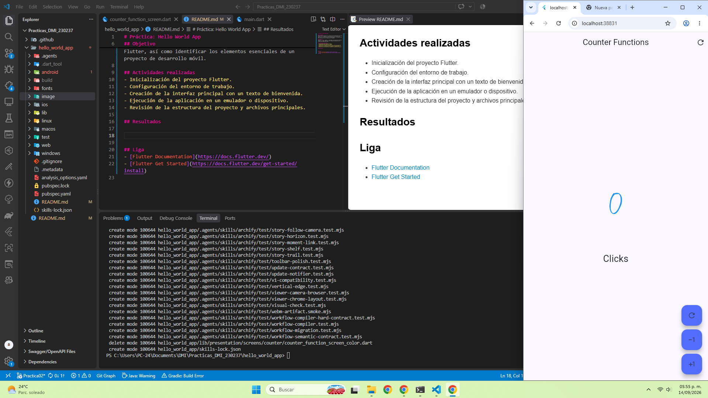
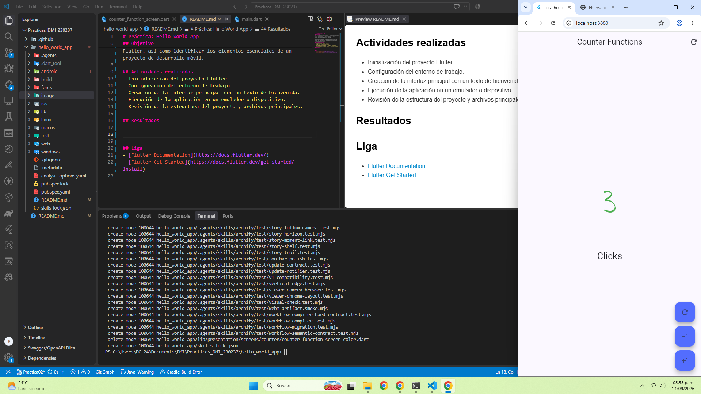

# Práctica 01: Hello World App

<div align="center">
  <table>
    <tr>
      <td align="center" valign="middle">
        
      </td>
      <td align="center" valign="middle">
        
      </td>
    </tr>
  </table>

  ### Desarrollo Móvil Integral

  **Introducción al desarrollo de aplicaciones móviles con Flutter**

  [](https://flutter.dev/)
  [](https://dart.dev/)
  [](https://developer.android.com/)
  [](https://m3.material.io/)
  [](https://github.com/)

  **[Ver repositorio en GitHub](https://github.com/KouDionicio/Practicas_DMI_230237)**

  **[Consultar diagrama de arquitectura](https://koudionicio.github.io/Practicas_DMI_230237/project_architecture.html)**
</div>

---

## Descripción

Esta práctica consiste en la creación de una aplicación básica con Flutter y Dart para familiarizarse con el entorno de desarrollo, la estructura de un proyecto móvil y la ejecución de una aplicación sencilla en un dispositivo, emulador o navegador.

El proyecto incluye una interfaz de contador que permite incrementar y decrementar valores, mostrando diferentes colores para representar el estado numérico.

## Objetivo

Aprender a crear, ejecutar y comprender una aplicación mínima en Flutter, identificando los elementos esenciales de un proyecto móvil y familiarizándose con la estructura del código, los widgets y la ejecución multiplataforma.

## Tecnologías utilizadas

| Tecnología | Icono | Aplicación |
|---|---|---|
| **Flutter** |  | Framework para crear la interfaz de usuario. |
| **Dart** |  | Lenguaje de programación de la aplicación. |
| **Material Design** |  | Componentes y estilos visuales. |
| **Android** |  | Plataforma para ejecutar y probar la aplicación. |
| **Git y GitHub** |  | Control de versiones y alojamiento del código fuente. |

## Actividades realizadas

- Inicialización del proyecto Flutter.
- Configuración del entorno de trabajo.
- Creación de la interfaz principal con un contador interactivo.
- Implementación de acciones para incrementar y decrementar el contador.
- Representación visual de valores positivos, negativos y del valor inicial.
- Ejecución de la aplicación en un emulador, dispositivo o navegador.
- Revisión de la estructura del proyecto y sus archivos principales.
- Consulta del diagrama de arquitectura para comprender la organización general.

## Funcionalidades

- **Contador inicial:** comienza en cero.
- **Incremento:** permite aumentar el valor del contador.
- **Decremento:** permite disminuir el valor del contador.
- **Indicadores de color:** azul para el valor inicial, verde para valores positivos y rojo para valores negativos, de acuerdo con las evidencias proporcionadas.
- **Interfaz interactiva:** actualiza el valor visible después de cada acción.

## Capturas de pantalla

Las evidencias se presentan en una cuadrícula de dos columnas para mantener un tamaño moderado y facilitar su comparación.

<table>
  <tr>
    <td align="center" width="50%">
      <strong>1. Contador en cero</strong><br><br>
      <br>
      <em>Valor inicial del contador antes de realizar alguna acción.</em>
    </td>
    <td align="center" width="50%">
      <strong>2. Números positivos</strong><br><br>
      <br>
      <em>Incremento del contador y representación de valores positivos.</em>
    </td>
  </tr>
  <tr>
    <td align="center" width="50%">
      <strong>3. Números negativos</strong><br><br>
      <br>
      <em>Decremento del contador y representación de valores negativos.</em>
    </td>
    <td align="center" width="50%">
      <strong>Resumen de la práctica</strong><br><br>
      <br>
      <em>Primera aproximación al desarrollo de interfaces con Flutter.</em>
    </td>
  </tr>
</table>

## Ejecución de la aplicación

Instala Flutter y configura un dispositivo, emulador o navegador compatible. Desde la carpeta raíz del proyecto, ejecuta:

```bash
flutter pub get
flutter run
```

Para comprobar el código y ejecutar las pruebas, si el proyecto dispone de ellas:

```bash
flutter analyze
flutter test
```

## Diagrama de arquitectura

Consulta el diagrama publicado mediante GitHub Pages:

<div align="center">

[](https://koudionicio.github.io/Practicas_DMI_230237/project_architecture.html)

**[Abrir diagrama de arquitectura](https://koudionicio.github.io/Practicas_DMI_230237/project_architecture.html)**

</div>

El diagrama complementa las evidencias visuales y permite consultar la organización general del proyecto.

## Resultados

Se creó una aplicación básica en Flutter con una interfaz funcional de contador. Se practicó la configuración del entorno, la construcción de widgets interactivos, la actualización de la interfaz y la ejecución del proyecto.

Las capturas documentan los estados del contador y el diagrama de arquitectura proporciona una referencia adicional para comprender la estructura de la aplicación.

## Conclusión

La práctica constituye una introducción al desarrollo móvil con Flutter y Dart. A través de una aplicación sencilla se exploran los fundamentos de la interfaz de usuario, la interacción, la actualización de estado y la organización de un proyecto, sentando las bases para desarrollar aplicaciones más complejas.

---

<div align="center">

**Práctica 01 · Desarrollo Móvil Integral**

*Flutter · Dart · Fundamentos del desarrollo móvil*

[Repositorio en GitHub](https://github.com/KouDionicio/Practicas_DMI_230237) · [Diagrama de arquitectura](https://koudionicio.github.io/Practicas_DMI_230237/project_architecture.html)

</div>