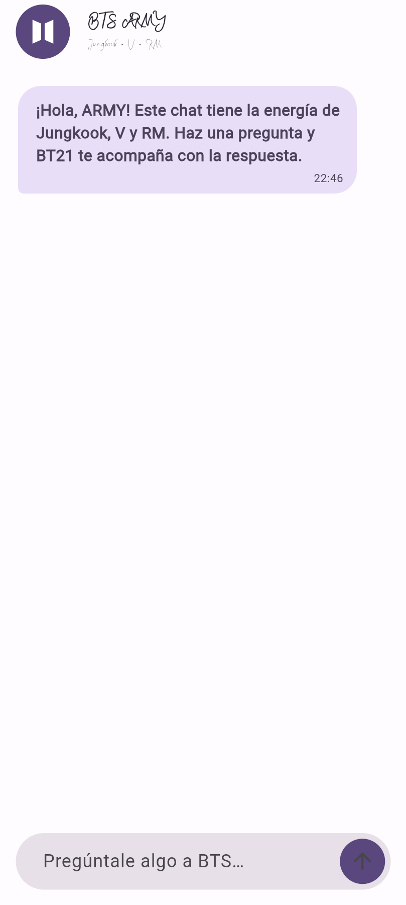
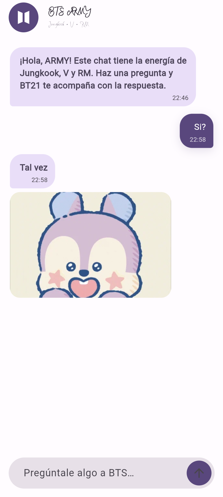
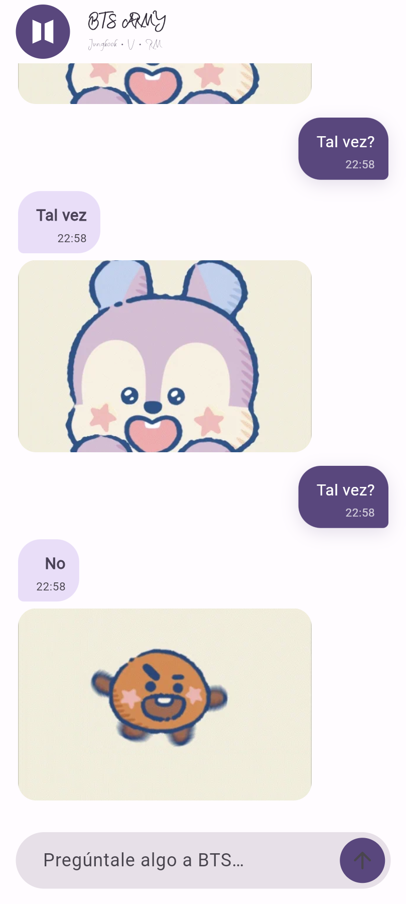
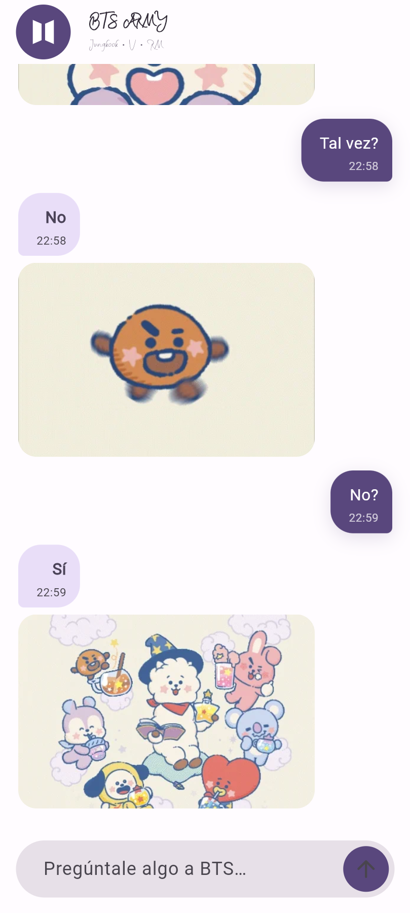

# Práctica 03: Sí, No, Maybe — Chat con API de respuestas automáticas

<div align="center">
  <table>
    <tr>
      <td align="center" valign="middle">
        
      </td>
      <td align="center" valign="middle">
        
      </td>
    </tr>
  </table>

  ### Desarrollo Móvil Integral

  **Aplicación móvil de chat con respuestas automáticas e integración de una API REST**

  [](https://flutter.dev/)
  [](https://dart.dev/)
  [](https://m3.material.io/)
  [](https://yesno.wtf/)
  [](https://pages.github.com/)
  [](https://github.com/)

  **[Ver repositorio en GitHub](https://github.com/KouDionicio/Practicas_DMI_230237)**

  **[Abrir aplicación web y diagrama](https://koudionicio.github.io/Practicas_DMI_230237/practica03/yes_no_app/)**
</div>

---

## Descripción

Aplicación de chat desarrollada con Flutter y Dart que consulta la API de [yesno.wtf](https://yesno.wtf/) cuando el usuario envía una pregunta terminada en `?`. La respuesta incluye una contestación automática y un GIF animado.

La interfaz está inspirada en las aplicaciones de mensajería y utiliza una temática visual BTS/ARMY, con mensajes fechados, burbujas de conversación y contenido multimedia.

## Objetivo

Implementar una aplicación móvil que consuma una API REST, procese respuestas automáticas y presente contenido multimedia dentro de una interfaz interactiva, aplicando administración de estado y separación de responsabilidades en Flutter.

## Tecnologías utilizadas

| Tecnología | Icono | Aplicación |
|---|---|---|
| **Flutter** |  | Desarrollo de la interfaz multiplataforma. |
| **Dart** |  | Lenguaje de programación. |
| **Material Design** |  | Componentes y estilos de interfaz. |
| **API REST** |  | Obtención de respuestas y GIFs desde yesno.wtf. |
| **Git y GitHub** |  | Control de versiones y alojamiento del código. |
| **GitHub Pages** |  | Publicación de la versión web y documentación. |
| **Android** |  | Instalación y ejecución en dispositivos Android. |

## Funcionalidades

- **Chat interactivo:** permite escribir y enviar mensajes.
- **Respuestas automáticas:** consulta yesno.wtf al detectar preguntas terminadas en `?`.
- **Respuestas ponderadas:** contempla Sí (40 %), No (40 %) y Tal vez (20 %).
- **GIF animados:** muestra el contenido multimedia devuelto por la API.
- **Hora local:** cada mensaje presenta su hora de envío.
- **Temática BTS/ARMY:** incorpora elementos visuales relacionados con BTS y BT21.
- **Iconografía personalizada:** cuenta con recursos de icono para Android y web.
- **Versión web:** permite ejecutar la aplicación publicada mediante GitHub Pages.

Las proporciones 40/40/20 representan las probabilidades configuradas. No garantizan que una conversación corta tenga exactamente esos porcentajes.

## Arquitectura y archivos principales

| Archivo | Responsabilidad |
|---|---|
| [`lib/main.dart`](lib/main.dart) | Punto de entrada y configuración principal de la aplicación. |
| [`lib/presentation/providers/chat_provider.dart`](lib/presentation/providers/chat_provider.dart) | Administración del estado y la lógica de la conversación. |
| [`lib/config/helpers/get_yes_no_answer.dart`](lib/config/helpers/get_yes_no_answer.dart) | Consulta de la API y procesamiento de la respuesta. |
| [`lib/domain/entities/message.dart`](lib/domain/entities/message.dart) | Entidad que representa los mensajes. |
| [`android/app/src/main/res/drawable/ic_yes_no.xml`](android/app/src/main/res/drawable/ic_yes_no.xml) | Recurso de iconografía para Android. |
| [`web/icons/yes-no-icon.svg`](web/icons/yes-no-icon.svg) | Icono de la versión web. |

## Evidencias de ejecución

Las capturas se presentan en una cuadrícula de dos columnas, con un ancho máximo para mantener una distribución compacta y facilitar su visualización.

<table>
  <tr>
    <td align="center" width="50%">
      <strong>1. Pantalla inicial BTS ARMY</strong><br><br>
      <br>
      <em>Bienvenida e identidad visual de la aplicación.</em>
    </td>
    <td align="center" width="50%">
      <strong>2. Respuesta con GIF de BT21</strong><br><br>
      <br>
      <em>Ejemplo de una respuesta automática con contenido multimedia.</em>
    </td>
  </tr>
  <tr>
    <td align="center" width="50%">
      <strong>3. Conversación con respuestas automáticas</strong><br><br>
      <br>
      <em>Intercambio de mensajes dentro del chat.</em>
    </td>
    <td align="center" width="50%">
      <strong>4. Varias respuestas de BT21</strong><br><br>
      <br>
      <em>Diferentes respuestas y animaciones durante una conversación.</em>
    </td>
  </tr>
</table>

### 5. Icono ARMY instalado en el celular

<em>Evidencia pendiente de agregar.</em>

Cuando tengas la captura del teléfono, colócala en `images/5.png` y utiliza este bloque:

```html
<div align="center">
  
</div>
```

## Ejecución y pruebas

Desde el directorio del proyecto, ejecuta:

```bash
flutter pub get
flutter run
```

Para ejecutar las pruebas automatizadas y revisar el código:

```bash
flutter test
flutter analyze
```

La versión web necesita conexión a internet para consultar la API y cargar los GIF animados.

## Publicación web y GitHub Pages

La aplicación y su documentación están disponibles en la siguiente dirección:

**[Abrir Práctica 03 en GitHub Pages](https://koudionicio.github.io/Practicas_DMI_230237/practica03/yes_no_app/)**

El código fuente se encuentra en el repositorio:

**[Ver repositorio de Practicas_DMI_230237](https://github.com/KouDionicio/Practicas_DMI_230237)**

## Conclusión

La práctica integra el consumo de una API REST, respuestas ponderadas y contenido multimedia en una interfaz de chat desarrollada con Flutter. La personalización BTS/ARMY, las marcas de tiempo y la publicación web complementan la experiencia, mientras que la separación entre presentación, estado, lógica de consulta y entidades facilita el mantenimiento del código.

---

<div align="center">

**Práctica 03 · Desarrollo Móvil Integral**

*Flutter · Dart · API REST · BTS/ARMY*

[Repositorio en GitHub](https://github.com/KouDionicio/Practicas_DMI_230237) · [Aplicación web](https://koudionicio.github.io/Practicas_DMI_230237/practica03/yes_no_app/)

</div>