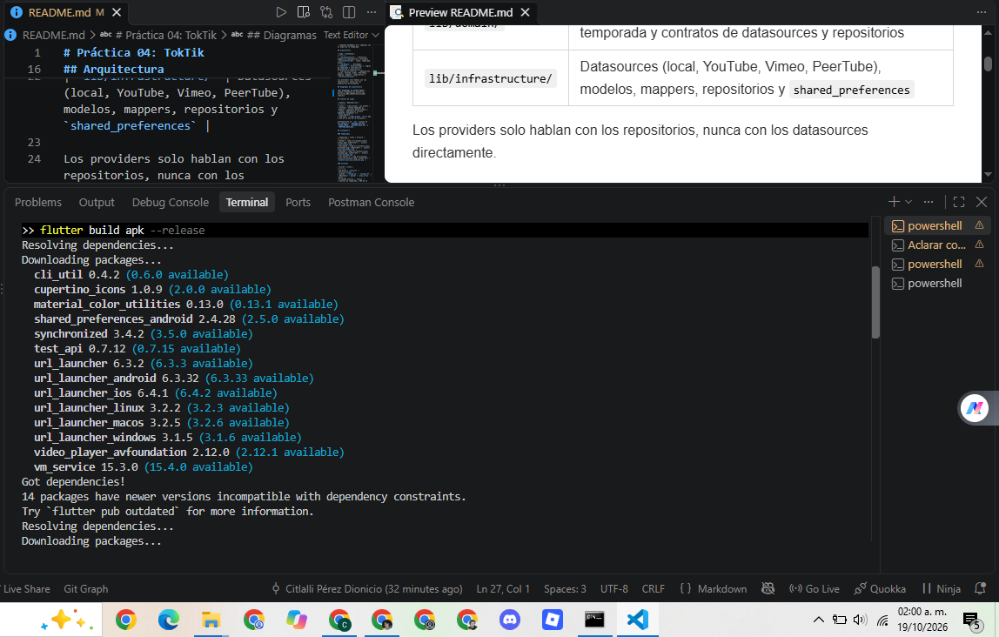
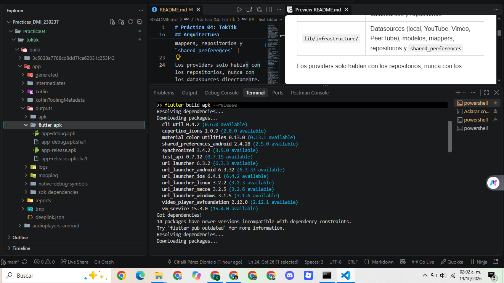
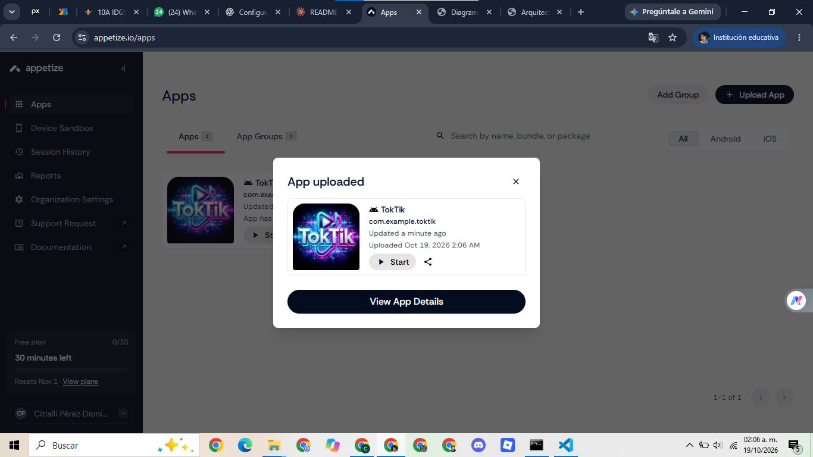
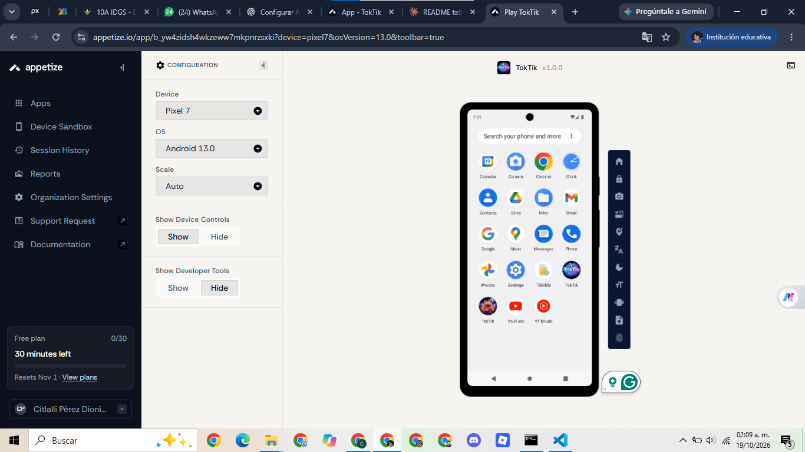
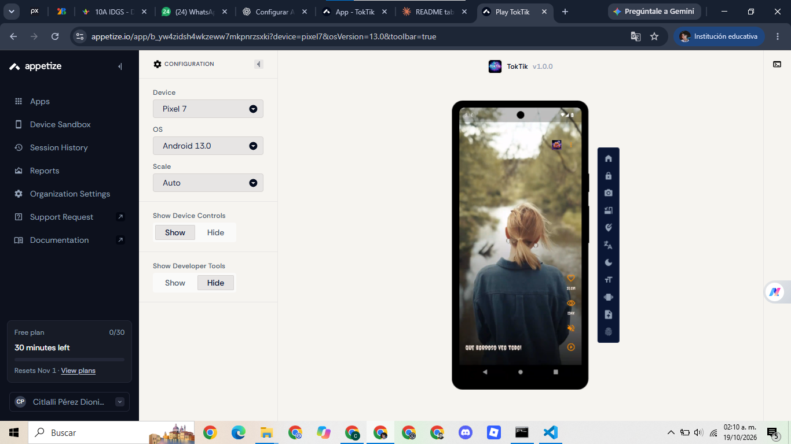
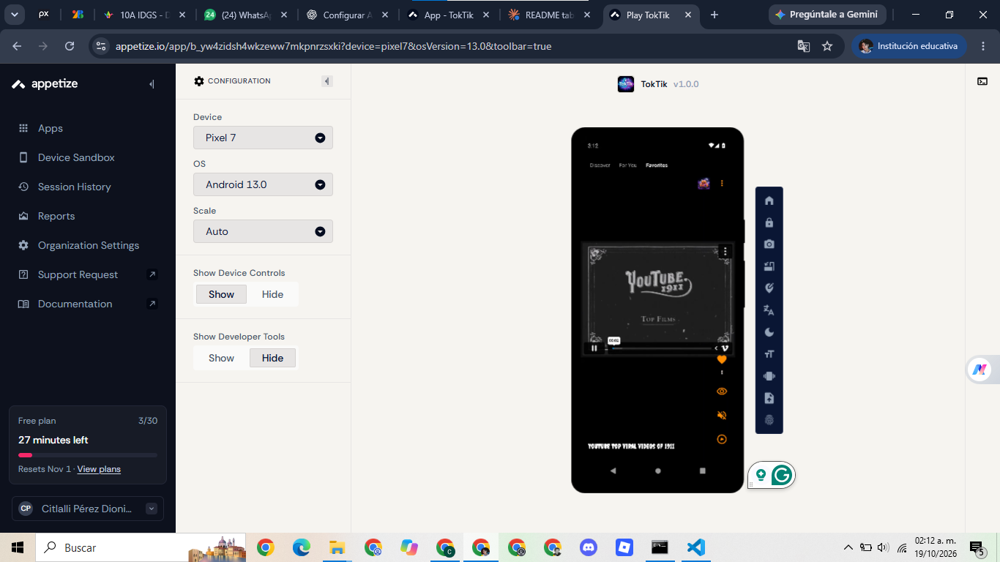

# Práctica 04: TokTik

Aplicación Flutter de videos verticales con scroll tipo TikTok, temas por temporada y videos locales y remotos (YouTube, Vimeo y PeerTube), siguiendo Clean Architecture.

## Funcionalidades

- **For You:** feed de videos locales (`assets/videos/`).
- **Discover:** videos remotos de YouTube, Vimeo y PeerTube, mezclados e intercalados. Si una fuente falla, las demás siguen apareciendo. Pagina al llegar cerca del final y deja al final los videos ya vistos.
- **Favorites:** videos con like, leídos desde `shared_preferences`.
- **Likes persistentes:** al desmarcar el corazón resta 1 y al marcarlo suma 1; el contador se guarda en el dispositivo.
- **Mute global:** un solo control de sonido compartido entre videos y secciones.
- **Descripción extensa:** se contrae con "... más" y se expande en una zona con scroll vertical.
- **Temas por temporada:** Halloween (1–31 oct.), Navidad (1 dic.–6 ene.), San Valentín (1–14 feb.) y Normal el resto del año. Cambian tipografía, audio, iconografía y paleta, según la fecha del dispositivo. Se puede elegir una temporada manualmente para pruebas (guardada en local storage).
- **Splash animado** de 3 segundos con el audio de la temporada.

## Arquitectura

| Capa | Contenido |
|---|---|
| `lib/presentation/` | Pantallas, widgets de reproducción y providers (`DiscoverProvider`, likes, temporada, audio) |
| `lib/domain/` | Entidades (`VideoPost`, `ExternalVideo`), reglas de temporada y contratos de datasources y repositorios |
| `lib/infrastructure/` | Datasources (local, YouTube, Vimeo, PeerTube), modelos, mappers, repositorios y `shared_preferences` |

Los providers solo hablan con los repositorios, nunca con los datasources directamente.

## Diagramas de arquitectura

[Ver diagramas en GitHub Pages](https://koudionicio.github.io/Practicas_DMI_230237/practica04/toktik/)

## Fuentes de video

| Fuente | Reproducción |
|---|---|
| Local | `video_player` con assets |
| YouTube | Iframe embebido en `WebView` (captions desactivados) |
| Vimeo | Reproductor oficial embebido; metadatos vía `vimeo_backend` |
| PeerTube | `video_player` con el mp4 o HLS de la API de la instancia |

Configuración en `.env` (copiar de `.env.example`): `YOUTUBE_API_KEY`, `VIMEO_TOKEN`, `BACKEND_BASE_URL` y `PEERTUBE_BASE_URL`.

## Iconografía

### Temporadas

| Temporada | Icono | Archivo |
|---|---|---|
| Normal |  | `assets/icons/normal.png` |
| Halloween |  | `assets/icons/halloween.png` |
| Navidad |  | `assets/icons/navidad.png` |
| San Valentín |  | `assets/icons/san_valentin.png` |

### Acciones

| Acción | Icono |
|---|---|
| Me gusta | `favorite` / `favorite_border` |
| Sonido | `volume_up` / `volume_off` |
| Reproducir / pausar | `play_arrow` / `pause` |
| Búsqueda externa | `search` |
| Ajustes de temporada | PNG de la temporada activa |

## Demostración en video

| Funcionalidad | Video |
|---|---|
| Temas por temporada | <video src="assets/video/temas.mp4" controls muted width="220"></video> |
| For You / Discover / Favorites | <video src="assets/video/secciones.mp4" controls muted width="220"></video> |
| Likes y mute | <video src="assets/video/likes_mute.mp4" controls muted width="220"></video> |
| YouTube, Vimeo y PeerTube | <video src="assets/video/proveedores.mp4" controls muted width="220"></video> |

Si el video no se muestra, ábrelo con estos enlaces:

| Funcionalidad | Enlace |
|---|---|
| Temas por temporada | [Ver video](assets/video/temas.mp4) |
| For You / Discover / Favorites | [Ver video](assets/video/secciones.mp4) |
| Likes y mute | [Ver video](assets/video/likes_mute.mp4) |
| YouTube, Vimeo y PeerTube | [Ver video](assets/video/proveedores.mp4) |

## Ejecutar

Desde `Practica04/toktik/`:

```sh
flutter pub get
flutter analyze
flutter run
```

Para Vimeo, iniciar antes el backend desde `Practica04/vimeo_backend/` con `npm start`.

## Publicación en Appetize

Appetize.io ejecuta aplicaciones Android desde el navegador, sin instalarlas en un teléfono ni publicarlas en Google Play. Es una publicación para demostración y pruebas.

**Enlace de la app:** [https://appetize.io/app/b_yw4zidsh4wkzeww7mkpnrzsxki](https://appetize.io/app/b_yw4zidsh4wkzeww7mkpnrzsxki)

### Preparación

- Permiso `INTERNET` declarado en `android/app/src/main/AndroidManifest.xml` (necesario en release para cargar videos remotos).
- `.env` fuera de Git. Se usa una API key de YouTube restringida a YouTube Data API v3 y un token de Vimeo de solo lectura.
- Vimeo en Appetize: como la app corre en la nube y no alcanza el backend local de la PC, `BACKEND_BASE_URL` se deja vacío y Flutter usa directamente `VIMEO_TOKEN`.

### Comandos

```sh
cd Practica04/toktik
flutter pub get
flutter analyze
flutter build apk --release
```

| Dato | Valor |
|---|---|
| Archivo | `build/app/outputs/flutter-apk/app-release.apk` |
| Tamaño | 155.9 MB |
| Versión | 1.0.0 (build 1) |
| Identificador | `com.example.toktik` |

### Procedimiento

1. Crear una cuenta en [appetize.io](https://appetize.io/) y entrar a *Upload App*.
2. Subir `app-release.apk` y esperar a que se procese.
3. Elegir el dispositivo Android virtual y la versión del sistema.
4. Iniciar la sesión, probar la app y copiar el enlace público.
5. Abrir el enlace en una ventana de incógnito para comprobar que funciona en una sesión independiente.

### Dispositivo de prueba

| Dispositivo | Sistema | Escala |
|---|---|---|
| Pixel 7 | Android 13.0 | Auto |

### Pruebas

| Prueba | Resultado | Notas |
|---|---|---|
| Instalación y apertura de la app | ✅ | La app aparece en el launcher y abre correctamente |
| For You (videos locales) | ✅ | Reproduce el video local con los iconos de la temporada (Halloween) |
| Discover: YouTube | ✅ | El reproductor de YouTube carga y se puede pausar |
| Discover: Vimeo | ⚠️ | Muestra el error con "Abrir en Vimeo" y "Reintentar" (ver incidencias) |
| Discover: PeerTube | TODO | |
| Favorites y likes | ✅ | El video con like aparece en Favorites con el corazón marcado |
| Mute | ✅ | El icono de sonido muestra el estado silenciado |
| Descripción "... más" | TODO | |
| Cambio de tema por temporada | TODO | |
| Interfaz sin desbordes ni cortes | ✅ | Se adapta a la pantalla del Pixel 7 |

Resultados: ✅ funciona, ⚠️ funciona con detalles, ❌ falla.

### Capturas

**Compilación y publicación**

| APK generado | Archivo del APK | App subida | 
|---|---|---|
|  |  |  | 

**Ejecución en Pixel 7 (Android 13.0)**

| Dispositivo y launcher | For You | Favorites con YouTube |
|---|---|---|
|  |  |  | 

### Incidencias

| Incidencia | Causa | Solución |
|---|---|---|
| Vimeo muestra "No se pudo abrir el reproductor oficial" (HTTP 403 de `challenges.cloudflare.com`) | Cloudflare bloquea la verificación anti-bots desde las IP del emulador en la nube | La app muestra el error con "Abrir en Vimeo" y "Reintentar" sin romper el feed; las demás fuentes siguen funcionando. En un teléfono físico reproduce con normalidad |
| APK de 155.9 MB | Incluye los 9 videos locales y los binarios de varias arquitecturas | Se subió completo; se puede reducir con `--split-per-abi` y comprimiendo los videos de `assets/videos/` |

### Ventajas y limitaciones

- **Ventajas:** no requiere dispositivo físico, se comparte con un enlace y permite probar varias pantallas y versiones de Android.
- **Limitaciones:** minutos de uso limitados en la cuenta gratuita (30 min), rendimiento y reproducción de video menores que en un teléfono real, bloqueos de servicios como Vimeo (Cloudflare) y sin acceso a servicios locales de la PC.

## Evidencia

| 1 | 2 | 3 |
|---|---|---|
|  |  |  |