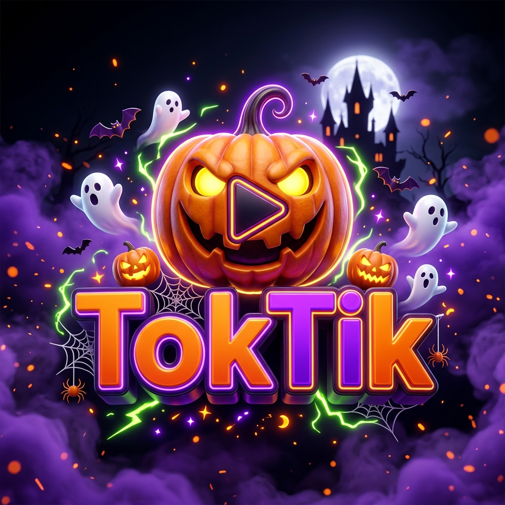
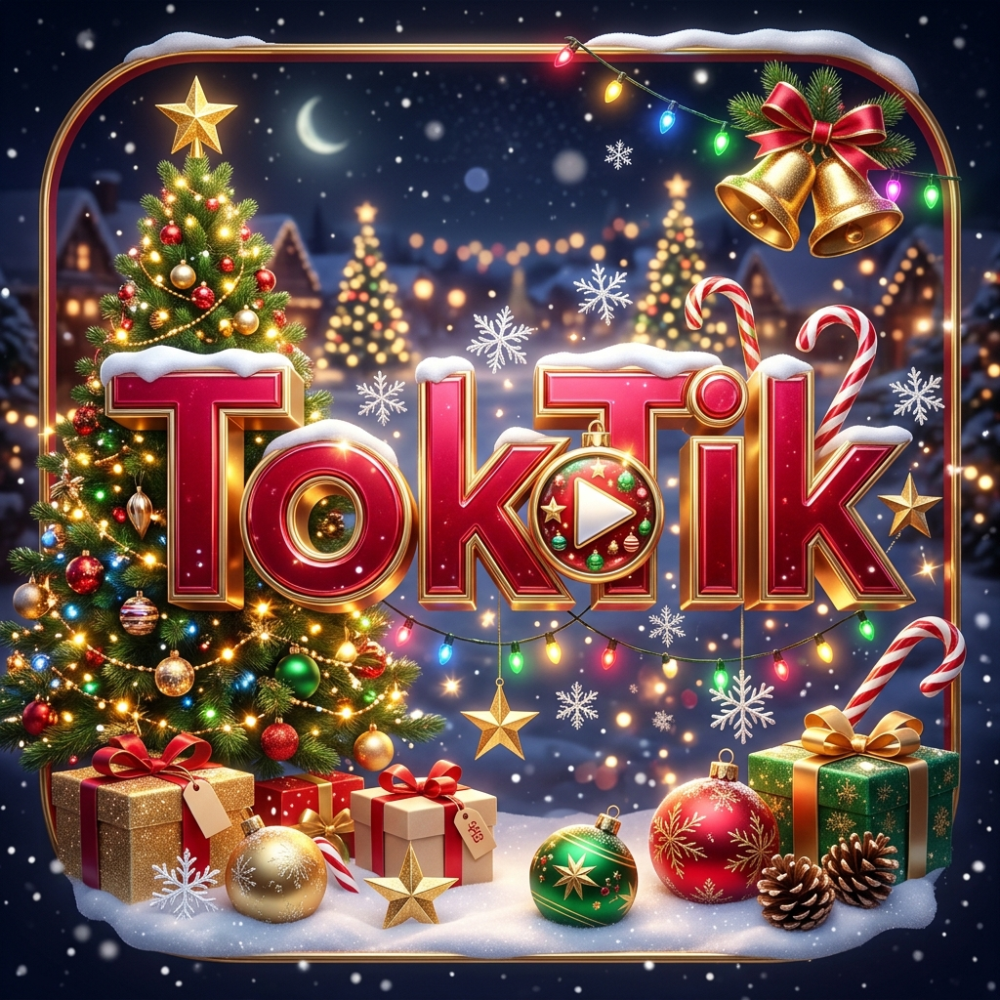

# Práctica 04: TokTik

Aplicación Flutter de videos verticales con scroll tipo TikTok, temas por temporada y videos locales y remotos (YouTube, Vimeo y PeerTube), siguiendo Clean Architecture.

## Funcionalidades

- **For You:** feed de videos locales (`assets/videos/`).
- **Discover:** videos remotos de YouTube, Vimeo y PeerTube, mezclados e intercalados. Si una fuente falla, las demás siguen apareciendo. Pagina al llegar cerca del final y deja al final los videos ya vistos.
- **Favorites:** videos con like, leídos desde `shared_preferences`.
- **Likes persistentes:** al desmarcar el corazón resta 1 y al marcarlo suma 1; el contador se guarda en el dispositivo.
- **Mute global:** un solo control de sonido compartido entre videos y secciones.
- **Descripción extensa:** se contrae con "... más" y se expande en una zona con scroll vertical.
- **Temas por temporada:** Halloween (1–31 oct.), Navidad (1 dic.–6 ene.), San Valentín (1–14 feb.) y Normal el resto del año. Cambian tipografía, audio, iconografía y paleta, según la fecha del dispositivo. Se puede elegir una temporada manualmente para pruebas (guardada en local storage).
- **Splash animado** de 3 segundos con el audio de la temporada.

## Arquitectura

| Capa | Contenido |
|---|---|
| `lib/presentation/` | Pantallas, widgets de reproducción y providers (`DiscoverProvider`, likes, temporada, audio) |
| `lib/domain/` | Entidades (`VideoPost`, `ExternalVideo`), reglas de temporada y contratos de datasources y repositorios |
| `lib/infrastructure/` | Datasources (local, YouTube, Vimeo, PeerTube), modelos, mappers, repositorios y `shared_preferences` |

Los providers solo hablan con los repositorios, nunca con los datasources directamente.

## Fuentes de video

| Fuente | Reproducción |
|---|---|
| Local | `video_player` con assets |
| YouTube | Iframe embebido en `WebView` (captions desactivados) |
| Vimeo | Reproductor oficial embebido; metadatos vía `vimeo_backend` |
| PeerTube | `video_player` con el mp4 o HLS de la API de la instancia |

Configuración en `.env` (copiar de `.env.example`): `YOUTUBE_API_KEY`, `VIMEO_TOKEN`, `BACKEND_BASE_URL` y `PEERTUBE_BASE_URL`.

## Iconografía

### Temporadas

| Temporada | Icono | Archivo |
|---|---|---|
| Normal |  | `assets/icons/normal.png` |
| Halloween |  | `assets/icons/halloween.png` |
| Navidad |  | `assets/icons/navidad.png` |
| San Valentín |  | `assets/icons/san_valentin.png` |

### Acciones

| Acción | Icono |
|---|---|
| Me gusta | `favorite` / `favorite_border` |
| Sonido | `volume_up` / `volume_off` |
| Reproducir / pausar | `play_arrow` / `pause` |
| Búsqueda externa | `search` |
| Ajustes de temporada | PNG de la temporada activa |

## Demostración en video

| Funcionalidad | Video |
|---|---|
| Temas por temporada | [](assets/video/temas.mp4) |
| For You / Discover / Favorites | [](assets/video/secciones.mp4) |
| Likes y mute | [](assets/video/likes_mute.mp4) |
| YouTube, Vimeo y PeerTube | [](assets/video/proveedores.mp4) |

## Ejecutar

Desde `Practica04/toktik/`:

```sh
flutter pub get
flutter analyze
flutter run
```

Para Vimeo, iniciar antes el backend desde `Practica04/vimeo_backend/` con `npm start`.

## Evidencia

| 1 | 2 | 3 |
|---|---|---|
|  |  |  |