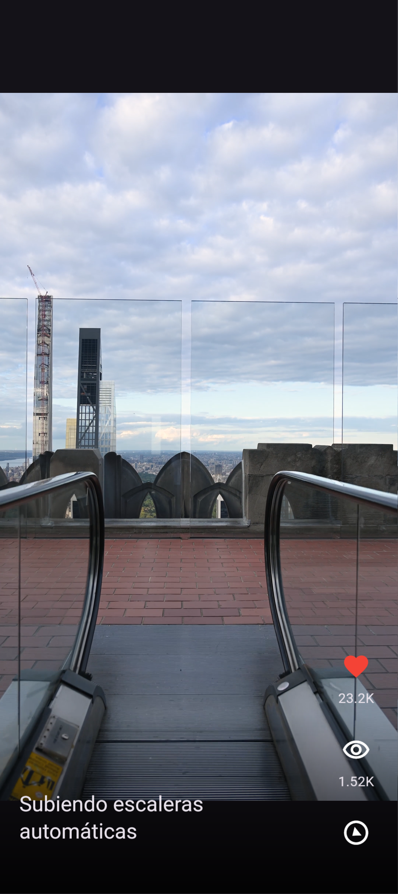
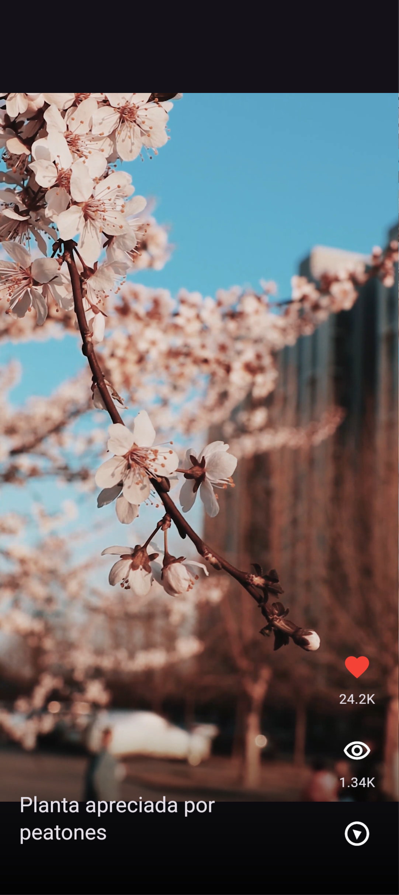
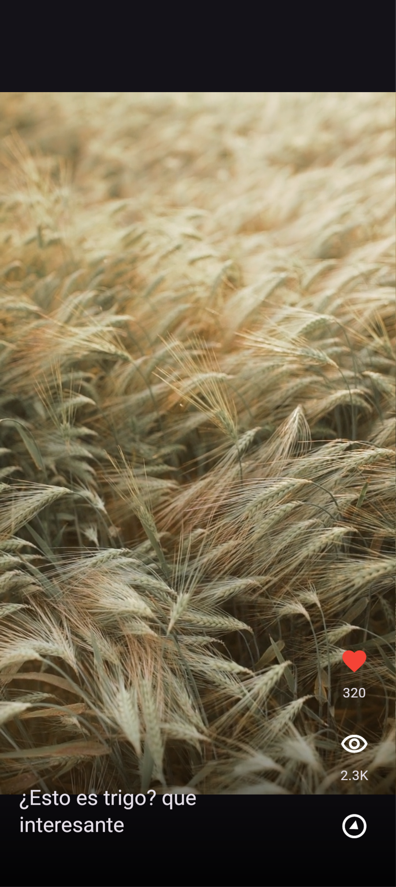
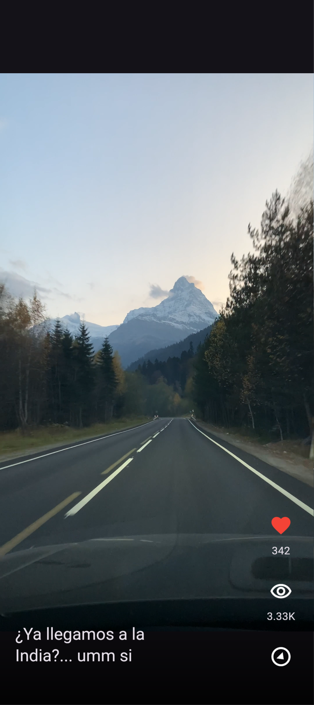
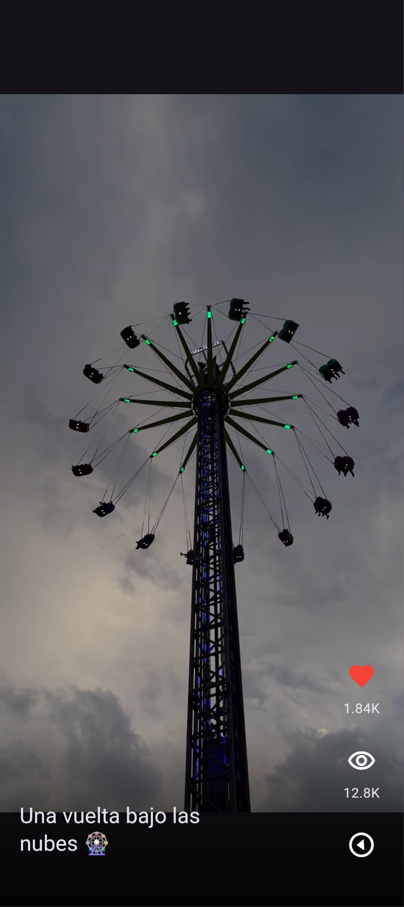
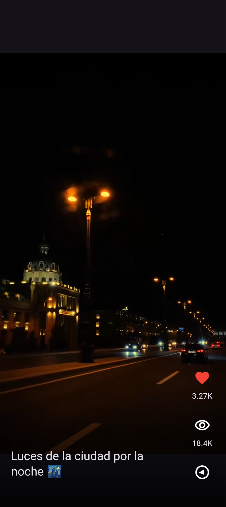
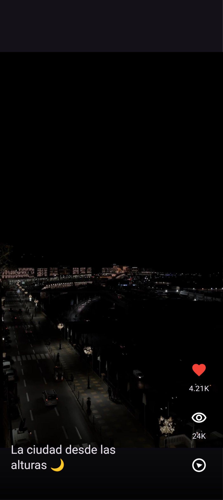
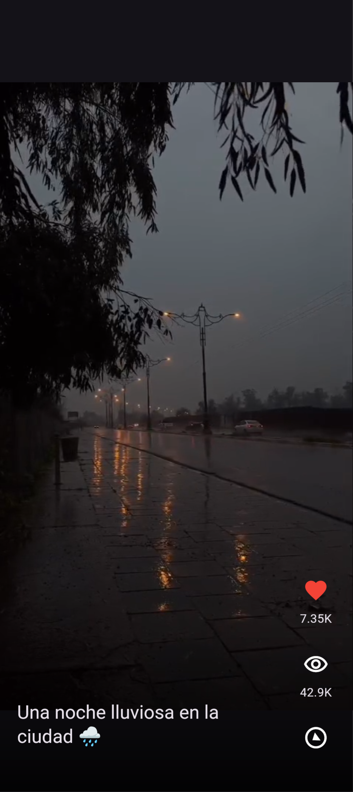

# Práctica 04: TokTik

Aplicación Flutter de videos cortos verticales. Conserva los 9 videos locales
de `assets/videos/` y añade temas de temporada, secciones, favoritos y controles
de reproducción.

## Funcionalidades

Android usa copias H.264 Main a 1080p/30 fps para los originales `1.mp4` y
`5.mp4`, cuya resolucion 4K excede la capacidad del decodificador del Redmi
Note 12S. Los originales permanecen en `assets/videos/`; las otras plataformas
siguen usando esos archivos.

- **Discover** intercala los videos locales con hasta tres resultados por
  proveedor de YouTube, Vimeo y PeerTube usando la búsqueda predeterminada
  `viral videos`. Si falta una llave o falla un proveedor, se omiten solo esos
  resultados y permanecen los videos locales y de otros proveedores. **For You**
  conserva su feed local ordenado por visualizaciones y **Favorites** consulta
  los IDs guardados.
- Un único reproductor activo: se inicializa al entrar en pantalla, se pausa
  durante interrupciones del sistema y se libera al salir del video o sección.
  Tocar el video pausa o reanuda el clip.
- El control de sonido está junto a las acciones del video. El estado se
  comparte entre páginas y secciones; los videos empiezan silenciados.
- El estado de like y el contador por video persisten en
  `shared_preferences`. Los IDs son estables y se derivan de la ruta local;
  al iniciar, se eliminan de las preferencias los likes y contadores de videos
  que ya no forman parte de la colección.
- La descripción larga se expande en una zona desplazable y se puede contraer.
- Temas automáticos según la fecha local, o selección manual desde el icono de
  temporada: Halloween (1–31 oct.), Navidad (1 dic.–6 ene.), San Valentín
  (1–14 feb.) y Normal el resto del año.
- El arranque presenta primero el splash nativo y después un splash Flutter
  animado de tres segundos con el audio de la temporada y fade out.
- El splash Flutter y el icono del launcher Android siguen el tema estacional
  efectivo; cambiar la temporada manual actualiza el audio mientras el splash
  está activo. El nombre Android/iOS siempre es `TokTik`. iOS mantiene el icono
  normal fijo.
- Like, mute, reproducción, ajustes y otros iconos Material usan el color
  principal de la temporada; el acceso a ajustes usa el PNG de esa temporada.
- El audio ambiental es opt-in, usa una sola instancia en loop y se pausa con
  el ciclo de vida; al activar sonido de video, la música se detiene para evitar
  mezclar ambas fuentes.

## Arquitectura y archivos

Se mantienen tres capas útiles para el alcance actual:

- `lib/presentation/`: pantalla, widgets de reproducción, `DiscoverProvider`,
  estado de likes, temporada y audio ambiental.
- `lib/domain/`: `VideoPost`, `ExternalVideo`, calendario/reglas de temporada
  y contratos de datasources y repositorios.
- `lib/infrastructure/`: datasources y repositorios separados para Discover,
  For You y Favorites; datasources/modelos/mappers de proveedores externos;
  almacenamiento con `shared_preferences`.
- `lib/shared/data/local_video_posts.dart`: metadatos de las 9 publicaciones.
- `test/`: límites de calendario, persistencia, mappers y widgets.

Cada feed local tiene su propio contrato de datasource y repositorio. Discover
conserva el orden local, For You ordena por visualizaciones y Favorites filtra
por los IDs persistidos. Los proveedores externos conservan su contrato común,
su datasource y su mapper por proveedor.

## Assets y dependencias

`pubspec.yaml` registra directorios reales `assets/videos/`, `assets/icons/`,
`assets/audio/normal/`, `assets/audio/halloween/` y
`assets/audio/christmas/`, `assets/audio/valentines/`. También registra las fuentes Inter, Creepster,
Pacifico, Playfair Display y Nunito desde sus rutas y nombres exactos.

Hay PNG existentes para Normal (`normal.png`), Halloween (`halloween.png`),
Navidad (`navidad.png`) y San Valentín (`san_valentin.png`), y audios de las
cuatro temporadas. El splash nativo usa un fondo neutral `#101020` sin mostrar el icono Normal; cuando Flutter carga las preferencias, el splash Flutter presenta el PNG de la temporada elegida y el audio estacional.

Paquetes principales: `provider`, `video_player`, `webview_flutter`, `web`,
`http`, `shared_preferences`, `audioplayers`, `flutter_native_splash`,
`flutter_launcher_icons`, `animate_do`, `intl` y `cupertino_icons`.
`video_player` reproduce assets locales y recursos multimedia PeerTube; YouTube
y Vimeo usan su reproductor embebido en Flutter Web o un iframe con origen HTTPS
dentro del WebView nativo.

## Proveedores externos: integración, credenciales y reproducción

Desde el botón de búsqueda externo se pueden elegir YouTube, Vimeo o
PeerTube. Cada fuente usa su datasource HTTP, mapper y repositorio común.
Los fallos de configuración, autorización, HTTP o respuesta inválida se
muestran en pantalla con proveedor, motivo y URL sin query/credenciales; no
ocultan ni reemplazan el feed local. El reproductor permite volver directamente
a Discover si una fuente externa no está disponible.

| Proveedor | Consulta de metadatos | Fuente exacta de reproducción | Configuración |
|---|---|---|---|
| YouTube | YouTube Data API v3 `search.list`, solo videos; extrae `items[].id.videoId` | La entidad conserva `youtube:{videoId}`; `WebViewController` abre `https://www.youtube.com/embed/{videoId}` en Android/iOS y un iframe HTML usa la misma URL en Chrome. No se manda la API key al reproductor. | `YOUTUBE_API_KEY`; requiere habilitar la API y restringir la clave |
| Vimeo | API de videos `GET /videos`, con Bearer token desde `Practica04/vimeo_backend` | Vimeo Player oficial en WebView | `VIMEO_ACCESS_TOKEN` solo en el entorno del backend y `VIMEO_BACKEND_URL` en Flutter |
| PeerTube | API pública `GET /api/v1/search/videos?search=...&count=25&sort=-views`; extrae `uuid` | Android/iOS consultan `GET /api/v1/videos/{uuid}` en la misma instancia y pasan primero `files[].fileUrl`, o si no existe `streamingPlaylists[].playlistUrl`, a `VideoPlayerController.networkUrl`. Chrome conserva el embed `https://{instancia}/videos/embed/{uuid}`. | `PEERTUBE_BASE_URL`, opcional; predeterminado `https://peertube.cpy.re` |

YouTube y Vimeo usan WebView nativa en Android/iOS y el `embedUrl` oficial en
Chrome. PeerTube nativo reproduce la URL HTTPS del archivo o playlist HLS
resuelta desde la API de detalles; la pantalla `/w/` nunca se usa como fuente
multimedia. `video_player` usa ExoPlayer en Android y AVPlayer en iOS, ambos
compatibles con HLS. En Chrome se mantiene el embed oficial para evitar
dependencias de CORS. En Android, el WebView de YouTube usa `https://com.example.toktik` como base para enviar el `Referer` de identidad requerido y fija el mismo `origin` al usar la IFrame API. No se envia la API key de busqueda al reproductor. Los videos con insercion bloqueada o restricciones de cuenta/region aun pueden fallar; se conserva el enlace al proveedor.

Vimeo extrae el ID numérico de `uri` (por ejemplo, `videos/12345`), lo conserva
como `vimeo:12345` y abre `https://player.vimeo.com/video/12345`.
Para la configuración actual de Flutter, Vimeo lee `BACKEND_BASE_URL` y
`VIMEO_TOKEN` de `.env`; `VIMEO_ACCESS_TOKEN` pertenece solo al backend.
`VIMEO_BACKEND_URL` ya no se lee desde Flutter. La celda de configuración
Vimeo de la tabla superior describe el contrato anterior y queda sustituida
por estas variables.

### Arquitectura, búsqueda y reproducción

`ExternalVideoDatasource` define la búsqueda; los datasources de YouTube,
Vimeo y PeerTube consultan sus APIs y los modelos de infraestructura mapean
metadatos a `ExternalVideo`. `ExternalVideoRepositoryImpl` selecciona el
datasource por `VideoSource`, y `ExternalVideoSearchProvider` alimenta la
pantalla de videos externos abierta desde Discover. Al tocar un resultado, se
abre el reproductor oficial verificado del proveedor.

La pantalla muestra errores de configuración, red y autenticación, y ofrece
volver directamente al feed local de Discover como fallback.

La búsqueda PeerTube usa la consulta de texto, pide hasta 25 resultados por
defecto y ordena por visualizaciones (`sort=-views`). El datasource limita
`count` a 1–100, codifica la consulta como parámetro URI y descarta UUIDs
duplicados. No necesita una API key para este endpoint público. Puedes cambiar
la instancia con `PEERTUBE_BASE_URL` en `.env`; debe ser HTTPS. El valor por
defecto es `https://peertube.cpy.re`.

La regla de calendario está centralizada en `SeasonCalendar` dentro del
dominio; `SeasonProvider` conserva y persiste los modos automático/manual y la
selección manual. La misma temporada efectiva actualiza el splash Flutter y el
launcher Android mediante cuatro `activity-alias` y un MethodChannel. iOS
mantiene el icono normal fijo y el nombre `TokTik`.

Durante el Landing nativo, `main()` resuelve la temporada y precarga el audio
local correspondiente. En el primer frame del splash Flutter se retira el
Landing y se reproduce el audio por tres segundos con fade out; el
`AudioPlayer` se libera antes de abrir Discover. El audio ambiental de la
pantalla principal sigue siendo opt-in y separado del audio introductorio. Si
un video solicita sonido, la música ambiental se detiene hasta que el video se
silencie o se abandone la sección.

### Regenerar el icono y refrescarlo en Android

Los cuatro iconos Android se generan desde los PNG existentes, manteniendo
recursos adaptive independientes para cada alias. Para regenerarlos desde esta
carpeta:

```sh
dart run tool/generate_seasonal_launcher_icons.dart
```

El script usa `flutter_launcher_icons` con la configuración normal de
`pubspec.yaml` y los archivos `launcher_icons_*.yaml`. Para forzar la
actualización en un dispositivo:

1. Desinstala la versión anterior (`adb uninstall com.example.toktik`) o
   desinstálala desde Android.
2. Ejecuta `flutter clean` y luego `flutter pub get`.
3. Instala de nuevo con `flutter run` o `flutter install`.
4. Si el launcher conserva el icono anterior, reinicia el dispositivo o espera
   a que actualice su caché.

Android cambia alias con `PackageManager` sin matar el proceso (`DONT_KILL_APP`), pero algunos launchers guardan en cache el icono y pueden refrescarlo con retraso. La pantalla nativa de Android usa solo el fondo neutral: Android 12+ recibe un drawable transparente como icono del sistema mientras Flutter carga la temporada guardada. Android 13+ puede mostrar el icono Normal sin tema en launchers que requieran una capa monocromatica, ya que no se define un asset monochrome estacional.

Para volver a generar los recursos del Landing nativo después de cambiar su
configuración:

```sh
dart run flutter_native_splash:create
```

Los resultados externos conservan su propio modelo `ExternalVideo`; no se
convierten a `VideoPost`, que pertenece al feed local. En PeerTube, el
adaptador de presentación resuelve la URL HTTPS del archivo/HLS desde los
metadatos del UUID y `video_player` reproduce ese recurso en Android/iOS. En
Chrome continúa el embed oficial. La disponibilidad depende de la instancia y
de que el archivo o playlist sea accesible.

### Configurar metadatos

1. En [Google Cloud Console](https://console.cloud.google.com/), crea o elige un
   proyecto, habilita **YouTube Data API v3** y crea una API key. Restringe la
   clave a esa API y a las cuotas previstas para el despliegue.
2. Copia `.env.example` a `.env` y configura las variables:

   ```dotenv
   YOUTUBE_API_KEY=TU_API_KEY_RESTRINGIDA
   VIMEO_TOKEN=TU_TOKEN_VIMEO_SOLO_LECTURA
   BACKEND_BASE_URL=
   PEERTUBE_BASE_URL=https://peertube.cpy.re
   ```

   `.env` se declara como asset y se empaqueta dentro del APK: cualquier
   persona que obtenga la aplicación puede extraer sus valores. Usa una API
   key de YouTube restringida a YouTube Data API v3 y con cuotas apropiadas.
   `VIMEO_TOKEN` debe tener solo permisos de lectura pública. `.gitignore`
   excluye `.env`; `.env.example` no contiene credenciales.
3. Si `BACKEND_BASE_URL` está configurado y el backend responde, Vimeo usa ese
   backend y el token permanece en el servidor. Si la URL no está configurada
   o hay un fallo de red al contactar el backend, Flutter usa directamente
   `VIMEO_TOKEN`. Una respuesta HTTP 401/403 o de otro error se muestra
   explícitamente y ofrece volver al feed local.
4. PeerTube no requiere credenciales. Si no se define `PEERTUBE_BASE_URL`, se
   usa `https://peertube.cpy.re`.
5. Ejecuta normalmente desde `Practica04/toktik/`, sin `--dart-define`:

   ```sh
   flutter pub get
   flutter run
   ```

6. En Discover, abre el botón de búsqueda externa, selecciona un proveedor,
   escribe una consulta y toca un resultado.

Vimeo requiere una aplicación registrada en
[Vimeo Developer](https://developer.vimeo.com/), permisos de lectura aprobados
y un access token con el alcance mínimo permitido por la cuenta (por ejemplo,
`public` para buscar videos públicos). Si se usa el backend independiente de
`Practica04/vimeo_backend`, este lee el token desde
`process.env.VIMEO_ACCESS_TOKEN` y hace proxy de `GET /videos`; Flutter llama a
`/api/vimeo/search` sin enviar el token del servidor.

#### Ejecutar Vimeo localmente

1. En Vimeo Developer crea/selecciona una aplicación, habilita el acceso de
   lectura correspondiente y genera un Personal Access Token con el alcance
   mínimo. Para el fallback directo, guárdalo como `VIMEO_TOKEN` en el `.env`
   local de Flutter; para el backend, configúralo como
   `VIMEO_ACCESS_TOKEN` solo en el entorno del backend.
2. El archivo `.env` de Flutter se empaqueta dentro del APK y su token se puede
   extraer. Usa exclusivamente un token de solo lectura, sin permisos de
   escritura, y no lo compartas ni lo guardes en Git. Para producción es más
   seguro dejar `VIMEO_TOKEN` vacío y usar solo el backend con HTTPS.
3. Desde `Practica04/vimeo_backend/`, inicia el backend:

   ```sh
   npm start
   ```

   En otra terminal ejecuta las pruebas:

   ```sh
   npm test
   ```

   `/health` debe responder `{"status":"ok"}`. El backend escucha en el puerto
   8787 y por defecto solo en `127.0.0.1`. Para un teléfono por depuración
   inalámbrica, establece `HOST=0.0.0.0` y configura `BACKEND_BASE_URL` con la
   IPv4 de la PC en la red local (por ejemplo `http://192.168.1.25:8787`).
   Ambos dispositivos deben estar en la misma red y esta no debe aislar clientes.
   Android permite HTTP cleartext únicamente en el build debug mediante
   `android/app/src/debug/AndroidManifest.xml`; usa HTTPS en release.
   No expongas ese endpoint de desarrollo a Internet.
   En producción, define `CORS_ALLOWED_ORIGINS` como una lista separada por
   comas de orígenes HTTPS exactos autorizados. Los orígenes HTTP locales solo
   se aceptan fuera de `NODE_ENV=production`; CORS no sustituye autenticación
   ni límites de uso. Configura `HOST` según la plataforma de despliegue y
   limita el acceso de red; `0.0.0.0` puede ser necesario dentro de un
   contenedor, pero no debe usarse para exponer el backend local a Internet.
4. En Windows permite el puerto TCP 8787 solo en el perfil privado del
   firewall (PowerShell como administrador):

   ```powershell
   New-NetFirewallRule -DisplayName "TokTik Vimeo Backend (Private)" -Direction Inbound -Action Allow -Protocol TCP -LocalPort 8787 -Profile Private
   ```

   Obtén la IPv4 de la PC con `ipconfig` y prueba
   `http://<IPv4-de-la-PC>:8787/health` en el navegador del celular. Debe
   responder `{"status":"ok"}`. Al ejecutar desde
   `Practica04/vimeo_backend/`, puedes iniciar con
   `$env:HOST="0.0.0.0"; npm start`.
5. En Videos externos elige Vimeo y busca. El backend no incluye el token en
   respuestas de error ni lo registra; reduce la respuesta a los campos que
   consume el mapper. Si no está configurado o no se puede alcanzar por red,
   Flutter intenta la API directa con el token de solo lectura de `.env`.

El backend de muestra no implementa autenticación de usuario ni despliegue
productivo. Mantén el servicio local; antes de publicarlo, protégelo con una
pasarela de autenticación/rate-limit y HTTPS, limita el uso de Vimeo y no
confíes en CORS como control de acceso. Configura `BACKEND_BASE_URL` en `.env`
con una URL accesible. El token del backend nunca va en Flutter; si habilitas
el fallback directo, `VIMEO_TOKEN` sí queda extraíble del APK y debe ser
estrictamente de solo lectura. En Vimeo revisa
[API authentication](https://developer.vimeo.com/api/authentication).

La pantalla de reproducción solo navega a HTTPS y a los hosts/rutas oficiales
de embed (`youtube.com/embed`, `player.vimeo.com/video` y
`{instancia}/videos/embed/{UUID}`). No se envían páginas web de proveedor a
`video_player`, ni se extraen o descargan streams. Se aplican los controles,
restricciones, disponibilidad regional, anuncios y permisos definidos por cada
servicio. Chrome inserta el embed HTTPS oficial del proveedor en un iframe
HTML y ofrece un enlace alternativo a la página del video si el proveedor
bloquea la inserción. Android e iOS conservan `webview_flutter` y muestran un
botón para abrir la página original del proveedor.

Referencias oficiales: [YouTube search.list](https://developers.google.com/youtube/v3/docs/search/list),
[YouTube IFrame API](https://developers.google.com/youtube/iframe_api_reference),
[políticas de YouTube API](https://developers.google.com/youtube/terms/developer-policies),
[Vimeo API](https://developer.vimeo.com/api/reference/videos),
[Vimeo Player SDK](https://developer.vimeo.com/player/sdk),
[PeerTube REST API: búsqueda de videos](https://docs.joinpeertube.org/api-rest-reference.html#tag/Videos/operation/getApiV1SearchVideos),
y [inserción de videos PeerTube](https://docs.joinpeertube.org/use-embed).

## Ejecutar y probar

Desde `Practica04/toktik/`:

```sh
flutter pub get
flutter run
dart format lib test
flutter analyze
flutter test
flutter test --platform chrome test/external_video_player_test.dart
```
El test de Chrome comprueba que el reproductor inserta un `HtmlElementView`
sin inicializar `webview_flutter`; ejecútalo con Chrome instalado.

En Windows, si `flutter pub get` termina con el mensaje de que los plugins
requieren symlinks, habilitar **Developer Mode** en la configuración del sistema
y volver a ejecutar el comando.

Las pruebas de `test/external_video_datasources_test.dart` usan HTTP simulado
para respuestas válidas, errores HTTP/autenticación, respuestas incompletas y
enrutamiento del repositorio; no contactan servicios reales. Las pruebas de
`test/domain_and_state_test.dart` cubren mappers, calendario y persistencia.
No se requieren credenciales ni Internet para el feed local. Las consultas
reales requieren la configuración indicada arriba; no se han ejecutado APIs
reales ni se afirma validada la reproducción en dispositivo.

Validación de esta revisión:

| Comando | Resultado |
|---|---|
| `flutter pub get` | Correcto; dependencias resueltas con los paquetes de icono y splash. |
| `flutter analyze` | Correcto: `No issues found!`. |
| `flutter test --reporter compact` | Correcto: 43 pruebas pasaron. |
| `flutter build apk --debug` | Correcto: se generó `build/app/outputs/flutter-apk/app-debug.apk`. |

Las pruebas de API usan HTTP simulado y no validan claves, cuotas ni
reproducción en servicios reales. No había dispositivo Android ni emulador
conectado (`flutter devices` solo mostró Windows, Chrome y Edge), así que queda
pendiente instalar y probar el APK y confirmar el refresco del icono en un
launcher real. Algunos launchers pueden mantener caché.

## Compilar APK y probar en Appetize.io

1. Instalar Android Studio y Android SDK, configurar `ANDROID_HOME` o el SDK en
   Flutter, instalar las herramientas de plataforma requeridas y aceptar las
   licencias con `flutter doctor --android-licenses`.
2. Desde esta carpeta, ejecutar:

   ```sh
   flutter pub get
   flutter build apk --debug
   ```

3. Verificar `build/app/outputs/flutter-apk/app-debug.apk` y cargar ese archivo
   en Appetize.io para una sesión de prueba Android.
4. Probar las cuatro temporadas desde el botón de configuración de temporada.
   Para probar reglas automáticas, cambiar la fecha local del dispositivo y
   reanudar la app; para pruebas deterministas, usar el modo manual.
5. Comprobar mute/unmute al cambiar de video y sección, likes tras reiniciar,
   Favorites vacío/lleno y expandir/contraer descripciones.

La compilación de APK requiere Android SDK local; no basta con tener Flutter.

## Evidencia de la práctica

Capturas incluidas con la práctica original:

| Publicación | Evidencia |
|---|---|
| 1 |  |
| 2 |  |
| 3 |  |
| 4 |  |
| 5 |  |
| 6 |  |
| 7 |  |
| 8 |  |
| 9 |  |
| 10 |  |
| 11 |  |
| 12 |  |
| 13 |  |
