# Práctica 05: Widgets App

<div align="center">
  <table>
    <tr>
      <td align="center" valign="middle">
        
      </td>
      <td align="center" valign="middle">
        
      </td>
    </tr>
  </table>

  <h2>Desarrollo Móvil Integral</h2>
  <p><strong>Aplicación móvil demostrativa de componentes e interfaces con Flutter</strong></p>

  <a href="https://flutter.dev/"></a>
  <a href="https://dart.dev/"></a>
  <a href="https://m3.material.io/"></a>
  <a href="https://pub.dev/packages/go_router"></a>
  <a href="https://riverpod.dev/"></a>
  <a href="https://pages.github.com/"></a>

  <br>

  **[Ver repositorio en GitHub](https://github.com/KouDionicio/Practicas_DMI_230237)**
</div>

---

##  Descripción

Widgets App es una aplicación desarrollada con Flutter y Dart para explorar diferentes componentes visuales e interactivos de Material Design 3 mediante pantallas demostrativas organizadas con un sistema de navegación.

El proyecto integra navegación declarativa con **GoRouter**, administración reactiva del estado mediante **Riverpod** y animaciones con **animate_do**. Su estructura modular facilita la organización del código, la reutilización de componentes y el mantenimiento de la aplicación.

##  Objetivo

Diseñar y desarrollar una aplicación móvil multiplataforma que permita experimentar con widgets de Flutter, navegación entre pantallas, gestión de estado, animaciones y personalización de temas, fortaleciendo las competencias en diseño de interfaces, interacción con el usuario y arquitectura de aplicaciones.

##  Tecnologías utilizadas

| Tecnología | Aplicación |
|---|---|
|  **Flutter** | Desarrollo de interfaces y aplicaciones multiplataforma. |
|  **Dart** | Lenguaje de programación de la aplicación. |
| **Material Design 3** | Componentes visuales, temas y controles de interfaz. |
| **GoRouter** | Definición y administración de rutas de navegación. |
| **Riverpod** | Gestión reactiva del estado y preferencias visuales. |
| **animate_do** | Efectos de animación para los elementos de la interfaz. |
|  **Android** | Plataforma para ejecutar y validar la aplicación. |
|  **Git y GitHub** | Control de versiones y alojamiento del código fuente. |

##  Funcionalidades

- Catálogo inicial de demostraciones y menú `NavigationDrawer` con accesos a las pantallas.
- Botones Material y tarjetas con diferentes estilos.
- Imágenes remotas con estados de carga y error.
- Indicadores de progreso indeterminados y reactivos basados en `StreamBuilder`.
- Notificaciones `SnackBar`, diálogos de confirmación y cuadro de información de la aplicación.
- Animaciones mediante `AnimatedContainer` y `FadeInRight`.
- Controles de selección e interacción.
- Tutorial introductorio con `PageView`.
- Lista con carga progresiva de imágenes y funcionalidad *Pull to Refresh*.
- Contador reactivo con Riverpod.
- Personalización del color principal y alternancia entre tema claro y oscuro.

## 📂 Estructura del proyecto

```text
widget_app/
├── assets/                  # Recursos y capturas de evidencia
├── lib/
│   ├── config/
│   │   ├── router/          # Configuración de rutas
│   │   └── theme/           # Temas y estilos
│   ├── presentation/
│   │   ├── providers/       # Estado y preferencias visuales
│   │   ├── screen/          # Pantallas demostrativas
│   │   └── widgets/         # Componentes reutilizables
│   └── main.dart             # Punto de entrada
├── test/                     # Pruebas automatizadas
├── pubspec.yaml               # Dependencias y recursos
└── README.md                  # Documentación de la práctica
```

*La estructura representa la organización general del proyecto. Los archivos y recursos concretos deben corresponder a la versión actual del repositorio.*

## ▶ Requisitos y ejecución

Se requiere tener instalado Flutter, con un SDK de Dart compatible con la versión declarada en `pubspec.yaml`, y disponer de un emulador o dispositivo compatible.

Desde la carpeta `Practica05/widget_app/`, ejecuta:

```bash
flutter pub get
flutter run
```

### Verificaciones automatizadas

Para analizar el código y ejecutar las pruebas:

```bash
flutter analyze
flutter test
```

### Compilación para Android

Para generar un APK de depuración:

```bash
flutter build apk --debug
```

Para generar un APK de distribución:

```bash
flutter build apk --release
```

El archivo de distribución se genera en:

```text
build/app/outputs/flutter-apk/app-release.apk
```

Para probar la aplicación en Appetize, es necesario cargar el APK en la plataforma y verificar la sesión de demostración. No se incluye un enlace público hasta que la publicación haya sido realizada y comprobada.

##  Diagramas de arquitectura y GitHub Pages

Los diagramas de arquitectura se encuentran en la carpeta `docs/` de la raíz del repositorio, separada del proyecto Flutter.

- [Índice de diagramas de Widgets App](https://koudionicio.github.io/Practicas_DMI_230237/practica05/widget_app/)
- [Arquitectura general interactiva](https://koudionicio.github.io/Practicas_DMI_230237/practica05/widget_app/architecture/general.html)
- [Pantallas, rutas y estado](https://koudionicio.github.io/Practicas_DMI_230237/practica05/widget_app/architecture/pantallas.html)
- [Menú de diagramas de las prácticas](https://koudionicio.github.io/Practicas_DMI_230237/diagramas/)

La publicación utiliza GitHub Pages. Comprueba los enlaces después de desplegar los cambios, ya que las rutas deben coincidir con los archivos publicados.

##  Evidencias de ejecución

Las siguientes capturas ilustran las diferentes pantallas de la aplicación. Se organizan en una cuadrícula de dos columnas y se limitan a un ancho de 260 píxeles para mantener una presentación compacta.

<table>
  <tr>
    <td align="center" width="50%">
      <strong>Menú principal</strong><br><br>
      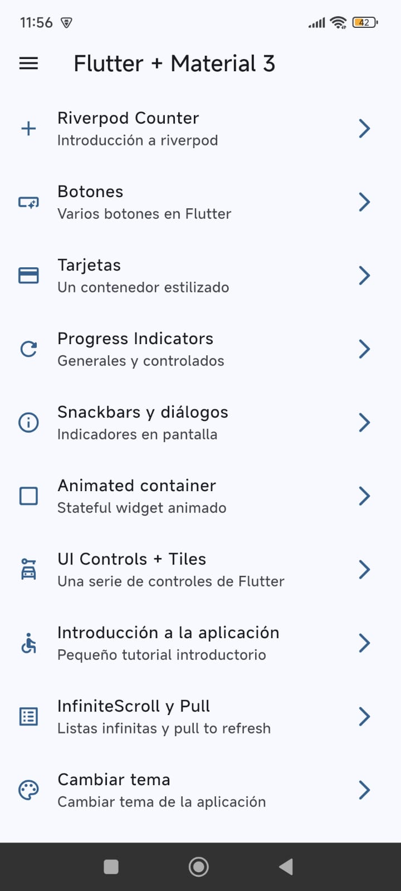
    </td>
    <td align="center" width="50%">
      <strong>Botones</strong><br><br>
      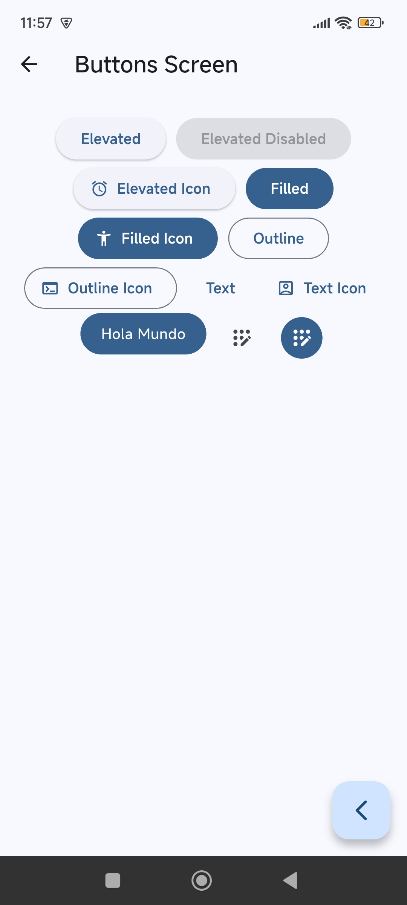
    </td>
  </tr>
  <tr>
    <td align="center" width="50%">
      <strong>Tarjetas</strong><br><br>
      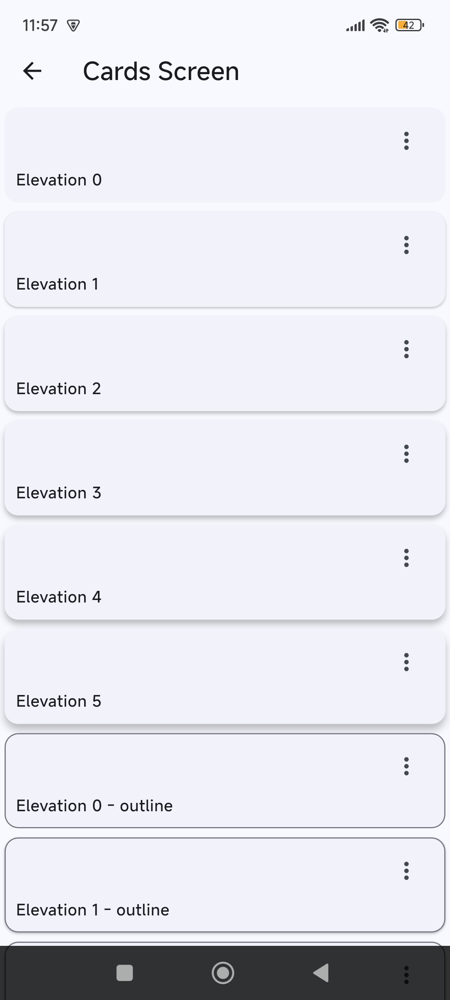
    </td>
    <td align="center" width="50%">
      <strong>Indicadores de progreso</strong><br><br>
      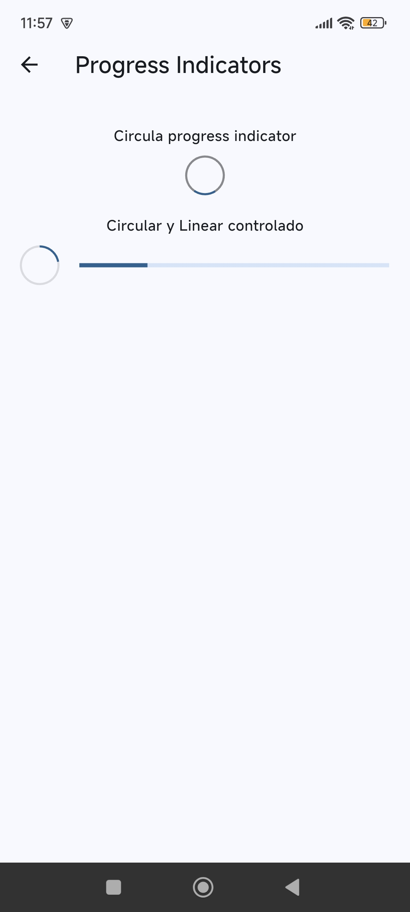
    </td>
  </tr>
  <tr>
    <td align="center" width="50%">
      <strong>Snackbars y diálogos</strong><br><br>
      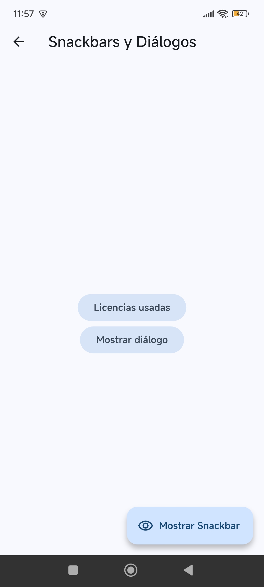
    </td>
    <td align="center" width="50%">
      <strong>Contenedor animado</strong><br><br>
      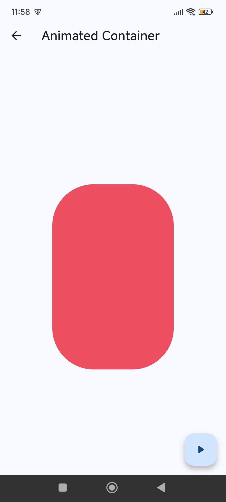
    </td>
  </tr>
  <tr>
    <td align="center" width="50%">
      <strong>Controles de interfaz</strong><br><br>
      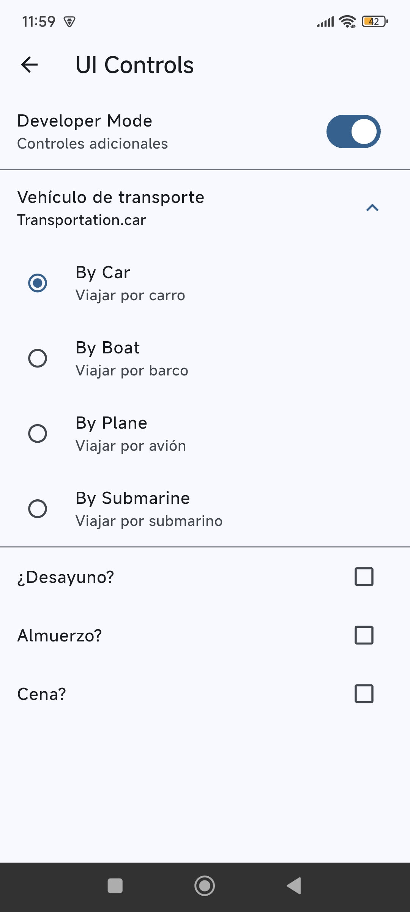
    </td>
    <td align="center" width="50%">
      <strong>Tutorial introductorio</strong><br><br>
      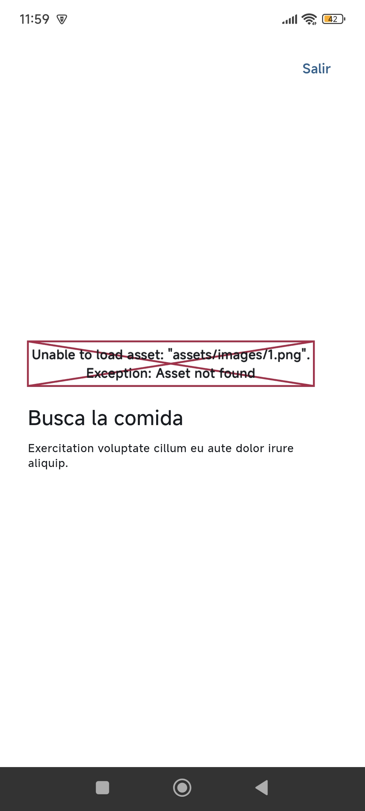
    </td>
  </tr>
  <tr>
    <td align="center" width="50%">
      <strong>Lista y actualización</strong><br><br>
      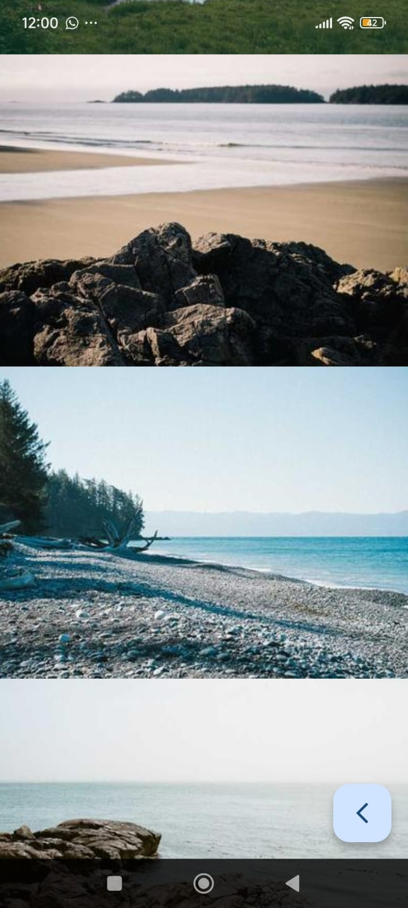
    </td>
    <td align="center" width="50%">
      <strong>Contador Riverpod</strong><br><br>
      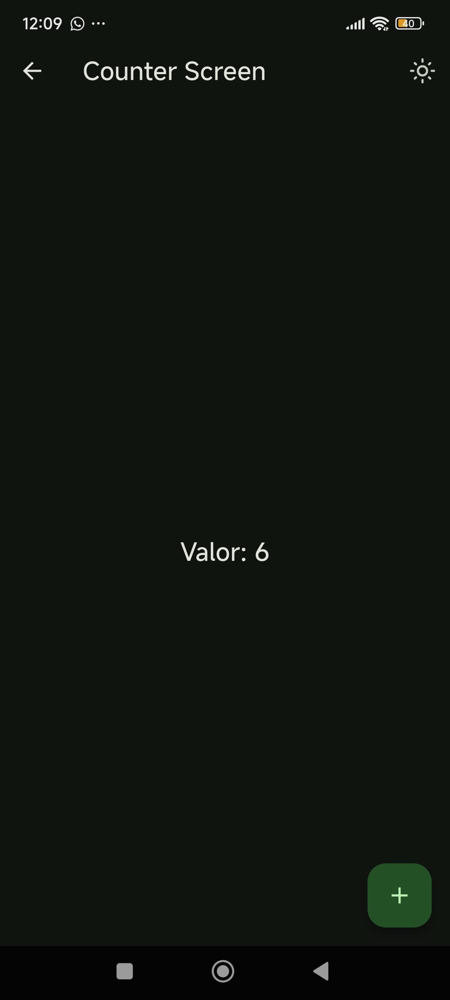
    </td>
  </tr>
  <tr>
    <td align="center" width="50%">
      <strong>Personalización del tema</strong><br><br>
      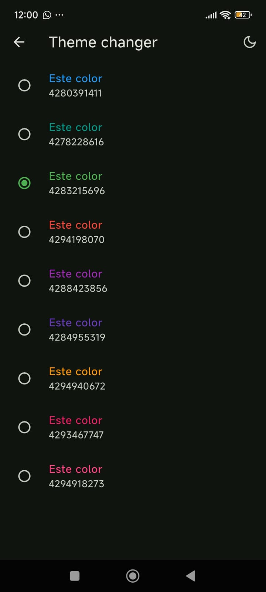
    </td>
    <td align="center" valign="middle">
      <em>Práctica 05 · Widgets App</em>
    </td>
  </tr>
</table>

> **Importante:** verifica que las once imágenes existan en `assets/` y que sus nombres y extensiones coincidan exactamente. Las capturas documentan la interfaz, pero no sustituyen los resultados de las pruebas automatizadas.

##  Estado de publicación

- **Código fuente:** [Repositorio de GitHub](https://github.com/KouDionicio/Practicas_DMI_230237).
- **Documentación:** disponible en este README.
- **Diagramas:** disponibles mediante GitHub Pages cuando el sitio esté desplegado y los enlaces hayan sido verificados.

##  Conclusión

La práctica permite explorar componentes fundamentales de Flutter y Material Design 3, integrando navegación, gestión reactiva del estado, animaciones y personalización visual en una aplicación modular.

La documentación, las capturas y los diagramas de arquitectura complementan el código fuente y facilitan la comprensión de la organización y el funcionamiento de la aplicación.

---

<div align="center">
  <strong>Práctica 05 · Desarrollo Móvil Integral</strong>
  <br>
  <sub>Flutter · Dart · Material Design 3</sub>
  <br><br>
  <a href="https://github.com/KouDionicio/Practicas_DMI_230237">Repositorio en GitHub</a>
</div>