# Práctica 06: Cinemapedia

<div align="center">
  <table>
    <tr>
      <td align="center" valign="middle">
        
      </td>
      <td align="center" valign="middle">
        
      </td>
      <td align="center" valign="middle">
        
      </td>
    </tr>
  </table>

  <h2>Desarrollo Móvil Integral</h2>
  <p><strong>Enciclopedia de cine multilingüe conectada a The Movie Database (TMDB)</strong></p>

  <a href="https://flutter.dev/"></a>
  <a href="https://dart.dev/"></a>
  <a href="https://m3.material.io/"></a>
  <a href="https://www.themoviedb.org/"></a>
  <a href="https://riverpod.dev/"></a>
  <a href="https://pub.dev/packages/go_router"></a>
  <a href="https://docs.flutter.dev/ui/accessibility-and-internationalization/internationalization"></a>
  <a href="https://pages.github.com/"></a>

  <br>

  **[Ver repositorio en GitHub](https://github.com/KouDionicio/Practicas_DMI_230237)**
</div>

---

##  Descripción

Cinemapedia es una aplicación desarrollada con Flutter y Dart que consulta la API de **The Movie Database (TMDB)** para mostrar películas en cartelera, próximos estrenos, títulos populares y mejor calificados, junto con su información detallada, reparto y clasificación por edad.

La aplicación está disponible en **ocho idiomas y regiones**. El país seleccionado determina tanto el idioma de toda la interfaz como los parámetros de consulta a TMDB (`language` y `region`) y el sistema de clasificación cinematográfica que se muestra. La preferencia se conserva entre sesiones.

El proyecto sigue una **arquitectura limpia** dividida en capas de dominio, infraestructura y presentación, con gestión reactiva del estado mediante **Riverpod**, navegación declarativa con **GoRouter** y peticiones HTTP con **Dio**.

##  Objetivo

Diseñar y desarrollar una aplicación móvil multiplataforma que consuma una API REST real, aplicando arquitectura por capas, gestión de estado, internacionalización completa (incluida la escritura de derecha a izquierda), persistencia de preferencias y diseño UX/UI con una identidad visual propia.

##  Tecnologías utilizadas

| Tecnología | Aplicación |
|---|---|
|  **Flutter** | Desarrollo de interfaces y aplicaciones multiplataforma. |
|  **Dart** | Lenguaje de programación de la aplicación. |
| **Material Design 3** | Componentes visuales, tema oscuro personalizado e iconografía. |
| **TMDB API** | Fuente de películas, reparto, títulos localizados y clasificaciones por país. |
| **Dio** | Cliente HTTP con tiempos de espera y manejo de errores de red. |
| **Riverpod** | Gestión reactiva del estado y configuración regional centralizada. |
| **GoRouter** | Definición y administración de rutas de navegación. |
| **flutter_localizations + intl** | Internacionalización oficial mediante archivos ARB y formatos regionales. |
| **SharedPreferences** | Persistencia del país e idioma seleccionados. |
| **flutter_dotenv** | Lectura segura de la API key desde el archivo `.env`. |
| **animate_do** | Animaciones de entrada en pantallas y componentes. |
|  **Android** | Plataforma para ejecutar y validar la aplicación, con icono adaptativo propio. |
|  **Git y GitHub** | Control de versiones y alojamiento del código fuente. |

##  Funcionalidades

- Pantalla de carga con el icono oficial, animación de entrada e inicialización real de datos.
- Carrusel de películas destacadas con flechas de navegación, gestos de deslizamiento y reproducción automática que se pausa al interactuar.
- Salto directo a la primera o a la última película mediante tres pulsaciones consecutivas en una flecha.
- Panel de información sincronizado con el carrusel: título localizado, título original, calificación con estrellas, clasificación por edad, fecha de estreno y sinopsis.
- Listas horizontales con carga infinita: en cines, próximamente, populares y mejor calificadas.
- Menú hamburguesa con apertura y cierre por botón o por gesto de deslizamiento.
- Pantalla de configuración con tarjetas visuales para elegir entre ocho países.
- Interfaz completa en español, inglés, alemán, francés, coreano, japonés, portugués y árabe, con dirección RTL en árabe.
- Clasificaciones cinematográficas obtenidas de TMDB para el país seleccionado, sin reutilizar las de otros países.
- Detalle de película con géneros, reparto, clasificación y calificación.
- Búsqueda de películas con espera inteligente entre pulsaciones de teclado.
- Mensajes de error traducidos con opción de reintentar cuando no hay conexión.
- Persistencia del país e idioma entre sesiones.
- Icono personalizado instalado en Android (clásico, redondo, adaptativo y monocromo) y pantalla de arranque nativa.

##  Configuración regional

| País | Código | Idioma | `language` (TMDB) | Sistema de clasificación |
|---|---|---|---|---|
| 🇲🇽 México | MX | Español | `es-MX` | RTC |
| 🇺🇸 Estados Unidos | US | English | `en-US` | MPA |
| 🇩🇪 Alemania | DE | Deutsch | `de-DE` | FSK |
| 🇫🇷 Francia | FR | Français | `fr-FR` | CNC |
| 🇰🇷 Corea del Sur | KR | 한국어 | `ko-KR` | KMRB |
| 🇯🇵 Japón | JP | 日本語 | `ja-JP` | Eirin |
| 🇧🇷 Brasil | BR | Português | `pt-BR` | ClassInd |
| 🇪🇬 Egipto | EG | العربية | `ar-EG` | Según disponibilidad en TMDB |

El código regional se envía como parámetro `region` en las consultas de cartelera, estrenos, populares, mejor calificadas y búsqueda. La clasificación de cada película se obtiene del endpoint `/movie/{id}/release_dates`; si TMDB no tiene datos para el país, la aplicación muestra un mensaje traducido indicando que no está disponible.

## 📂 Estructura del proyecto

```text
cinemapedia/
├── android/                     # Configuración Android, icono adaptativo y splash nativo
├── assets/
│   ├── evidencias/              # Capturas de evidencia (no se incluyen en el APK)
│   └── icono/                   # Icono oficial de Cinemapedia
├── lib/
│   ├── config/
│   │   ├── constants/           # Variables de entorno y configuración de regiones
│   │   ├── helpers/             # Formatos regionales y utilidades de traducción
│   │   ├── router/              # Configuración de rutas
│   │   └── theme/               # Tema y paleta de colores
│   ├── domain/
│   │   ├── datasources/         # Contratos de origen de datos
│   │   ├── entities/            # Película, actor y clasificación
│   │   ├── errors/              # Excepciones de dominio
│   │   └── repositories/        # Contratos de repositorios
│   ├── infrastructure/
│   │   ├── datasource/          # Cliente TMDB y datasources
│   │   ├── mappers/             # Conversión de modelos a entidades
│   │   ├── models/              # Modelos de respuesta de TMDB
│   │   └── repositories/        # Implementaciones de repositorios
│   ├── l10n/                    # Traducciones ARB y código generado
│   ├── presentation/
│   │   ├── delegates/           # Búsqueda de películas
│   │   ├── providers/           # Estado, películas y configuración regional
│   │   ├── screens/             # Splash, inicio, detalle y configuración
│   │   ├── views/               # Inicio, categorías y favoritos
│   │   └── widgets/             # Componentes reutilizables
│   └── main.dart                # Punto de entrada
├── test/
│   ├── unit/                    # Pruebas de lógica, regiones y TMDB
│   └── widget/                  # Pruebas de navegación, carrusel e idiomas
├── l10n.yaml                    # Configuración de internacionalización
├── pubspec.yaml                 # Dependencias y recursos
└── README.md                    # Documentación de la práctica
```

*La estructura representa la organización general del proyecto. Los archivos y recursos concretos deben corresponder a la versión actual del repositorio.*

## ▶ Requisitos y ejecución

Se requiere tener instalado Flutter, con un SDK de Dart compatible con la versión declarada en `pubspec.yaml`, disponer de un emulador o dispositivo compatible y contar con una **API key de TMDB** (se obtiene gratuitamente en [themoviedb.org](https://www.themoviedb.org/settings/api)).

### Configuración de la API key

Crea un archivo `.env` en la raíz del proyecto con el siguiente contenido:

```env
THE_MOVIEDB_KEY=tu_api_key_de_tmdb
```

> **Importante:** el archivo `.env` contiene información privada y no debe subirse al repositorio. Verifica que esté incluido en `.gitignore`.

### Ejecución

Desde la carpeta `Practica06/cinemapedia/`, ejecuta:

```bash
flutter pub get
flutter run
```

El comando `flutter pub get` también regenera las traducciones a partir de los archivos ARB de `lib/l10n/`.

### Verificaciones automatizadas

Para analizar el código y ejecutar las pruebas:

```bash
flutter analyze
flutter test
```

### Compilación para Android

Para generar un APK de depuración:

```bash
flutter build apk --debug
```

Para generar un APK de distribución:

```bash
flutter build apk --release
```

El archivo de distribución se genera en:

```text
build/app/outputs/flutter-apk/app-release.apk
```

Si la aplicación ya estaba instalada, desinstálala antes de instalar la nueva versión para que el launcher muestre el icono actualizado.

Para probar la aplicación en Appetize, es necesario cargar el APK en la plataforma y verificar la sesión de demostración. No se incluye un enlace público hasta que la publicación haya sido realizada y comprobada.

##  Diagramas de arquitectura y GitHub Pages

Los diagramas de arquitectura se encuentran en la carpeta `docs/` de la raíz del repositorio, separada del proyecto Flutter.

- [Índice de diagramas de Cinemapedia](https://koudionicio.github.io/Practicas_DMI_230237/practica06/cinemapedia/)
- [Arquitectura general por capas](https://koudionicio.github.io/Practicas_DMI_230237/practica06/cinemapedia/architecture/general.html)
- [Pantallas, rutas y estado](https://koudionicio.github.io/Practicas_DMI_230237/practica06/cinemapedia/architecture/pantallas.html)
- [Menú de diagramas de las prácticas](https://koudionicio.github.io/Practicas_DMI_230237/diagramas/)

La publicación utiliza GitHub Pages. Comprueba los enlaces después de desplegar los cambios, ya que las rutas deben coincidir con los archivos publicados.

##  Evidencias de ejecución

Las siguientes capturas ilustran las diferentes pantallas de la aplicación. Se organizan en una cuadrícula de dos columnas y se limitan a un ancho de 260 píxeles para mantener una presentación compacta.

<table>
  <tr>
    <td align="center" width="50%">
      <strong>Pantalla de carga</strong><br><br>
      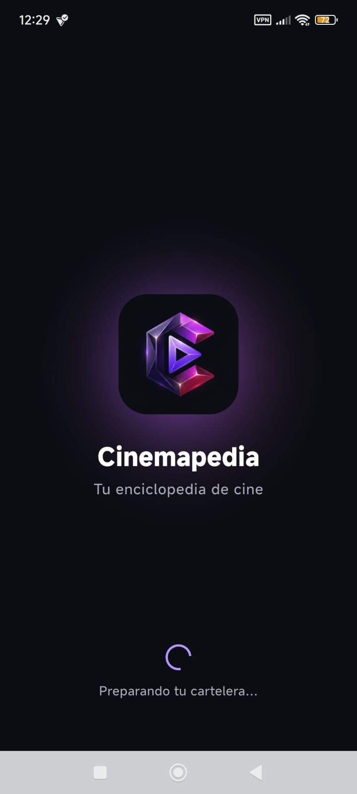
    </td>
    <td align="center" width="50%">
      <strong>Inicio y carrusel destacado</strong><br><br>
      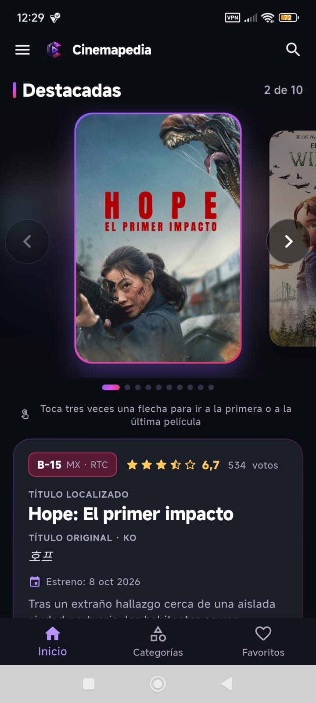
    </td>
  </tr>
  <tr>
    <td align="center" width="50%">
      <strong>Panel de información</strong><br><br>
      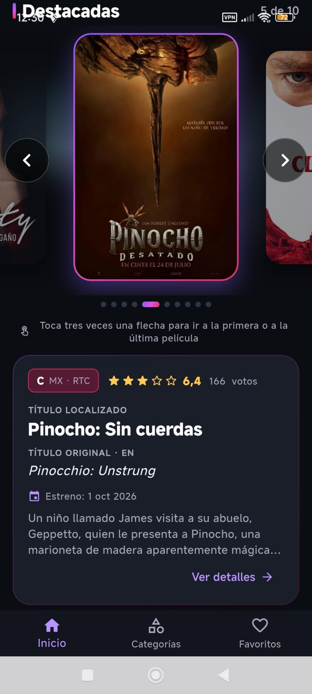
    </td>
    <td align="center" width="50%">
      <strong>Salto por triple pulsación</strong><br><br>
      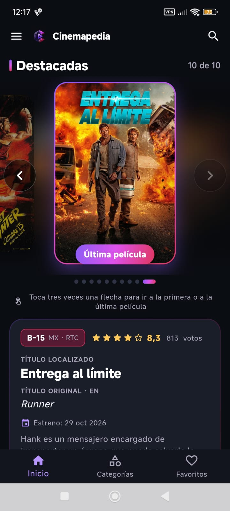
    </td>
  </tr>
  <tr>
    <td align="center" width="50%">
      <strong>Listas de películas</strong><br><br>
      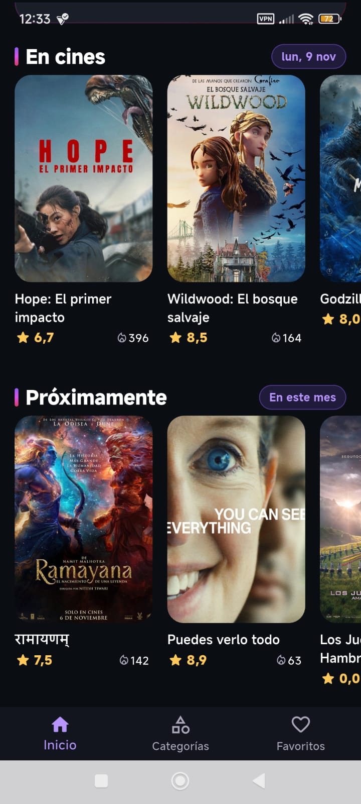
    </td>
    <td align="center" width="50%">
      <strong>Menú hamburguesa</strong><br><br>
      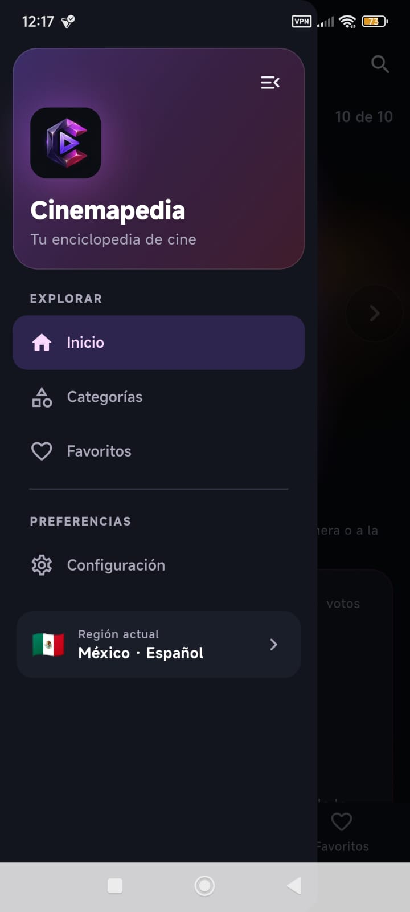
    </td>
  </tr>
  <tr>
    <td align="center" width="50%">
      <strong>Configuración de región</strong><br><br>
      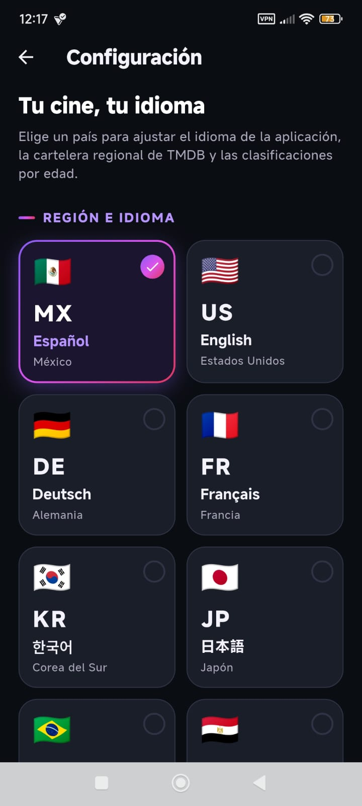
    </td>
    <td align="center" width="50%">
      <strong>Interfaz en japonés</strong><br><br>
      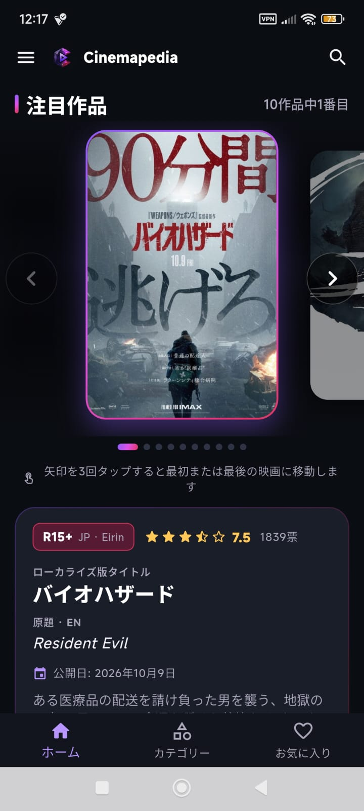
    </td>
  </tr>
  <tr>
    <td align="center" width="50%">
      <strong>Interfaz en coreano</strong><br><br>
      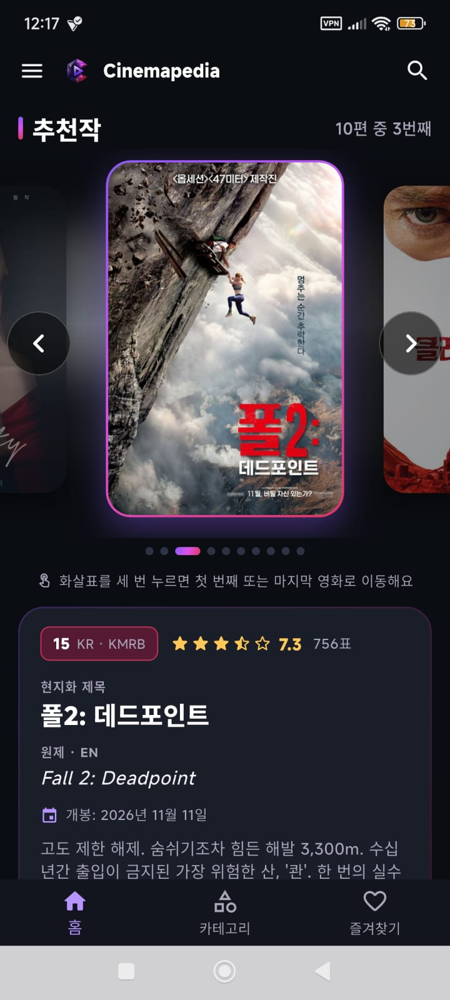
    </td>
    <td align="center" width="50%">
      <strong>Interfaz en árabe (RTL)</strong><br><br>
      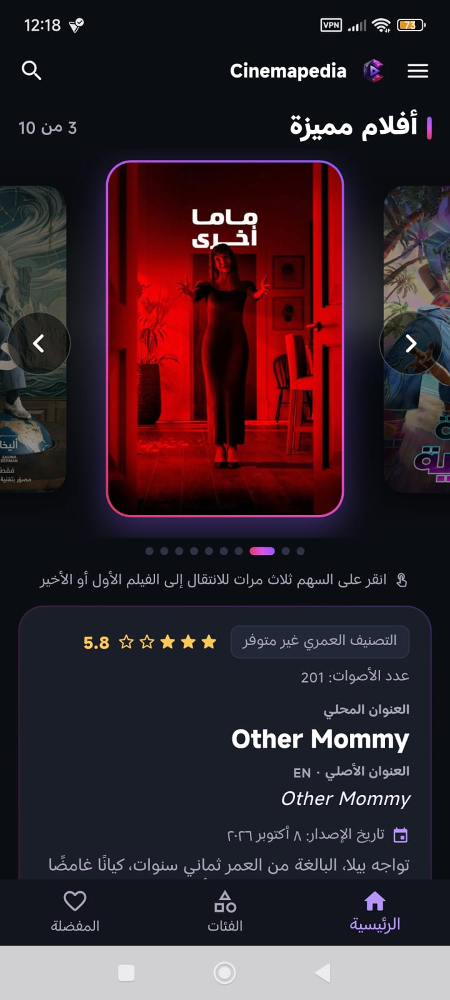
    </td>
  </tr>
  <tr>
    <td align="center" width="50%">
      <strong>Detalle de película</strong><br><br>
      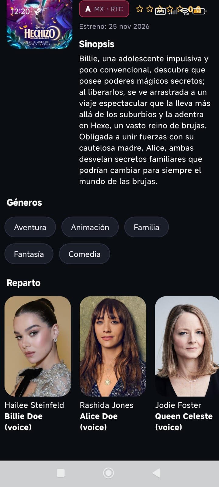
    </td>
    <td align="center" width="50%">
      <strong>Clasificación no disponible</strong><br><br>
      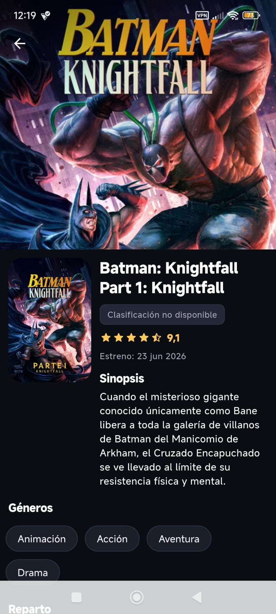
    </td>
  </tr>
  <tr>
    <td align="center" width="50%">
      <strong>Búsqueda de películas</strong><br><br>
      
    </td>
    <td align="center" width="50%">
      <strong>Favoritos y categorías</strong><br><br>
      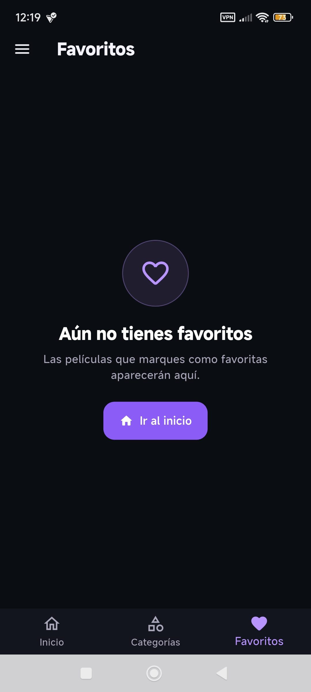
    </td>
  </tr>
  <tr>
    <td align="center" width="50%">
      <strong>Error de conexión</strong><br><br>
      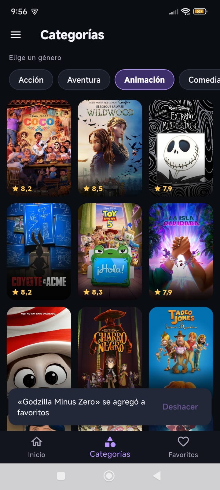
    </td>
    <td align="center" width="50%">
      <strong>Icono instalado en Android</strong><br><br>
      
    </td>
  </tr>
</table>


##  Estado de publicación

- **Código fuente:** [Repositorio de GitHub](https://github.com/KouDionicio/Practicas_DMI_230237).
- **Documentación:** disponible en este README.
- **Diagramas:** disponibles mediante GitHub Pages cuando el sitio esté desplegado y los enlaces hayan sido verificados.
- **Pendiente:** las secciones de Favoritos y Categorías muestran un estado vacío; su funcionalidad completa queda para una versión posterior.

##  Conclusión

La práctica permite integrar el consumo de una API REST real con una arquitectura por capas, gestión reactiva del estado e internacionalización completa, incluyendo idiomas asiáticos y escritura de derecha a izquierda.

La separación entre idioma y región demuestra que una aplicación localizada debe adaptar no solo sus textos, sino también los datos que consulta y la información regional que presenta, como las clasificaciones cinematográficas de cada país.

---

<div align="center">
  <strong>Práctica 06 · Desarrollo Móvil Integral</strong>
  <br>
  <sub>Flutter · Dart · TMDB · Material Design 3</sub>
  <br><br>
  <a href="https://github.com/KouDionicio/Practicas_DMI_230237">Repositorio en GitHub</a>
</div>